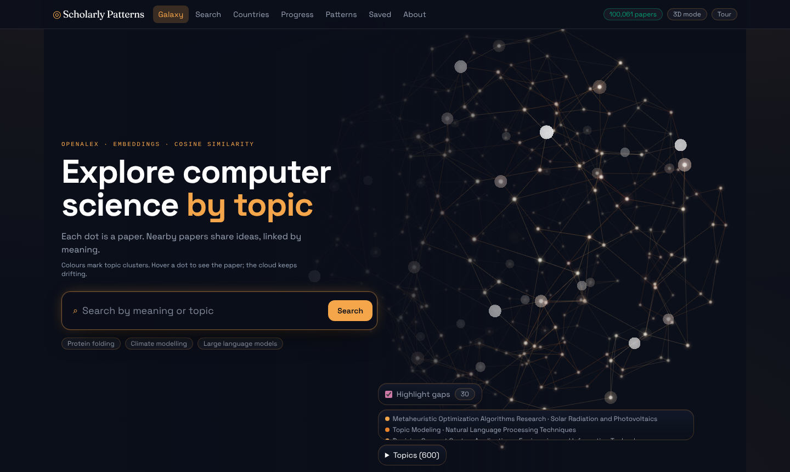
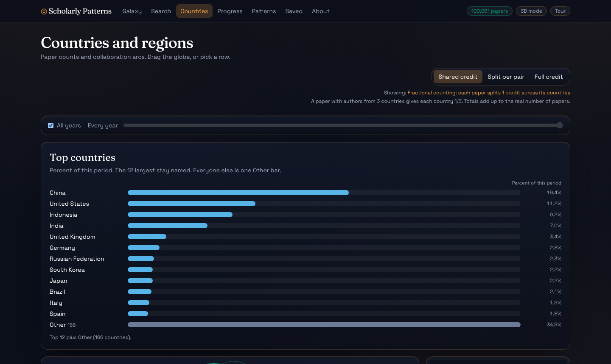
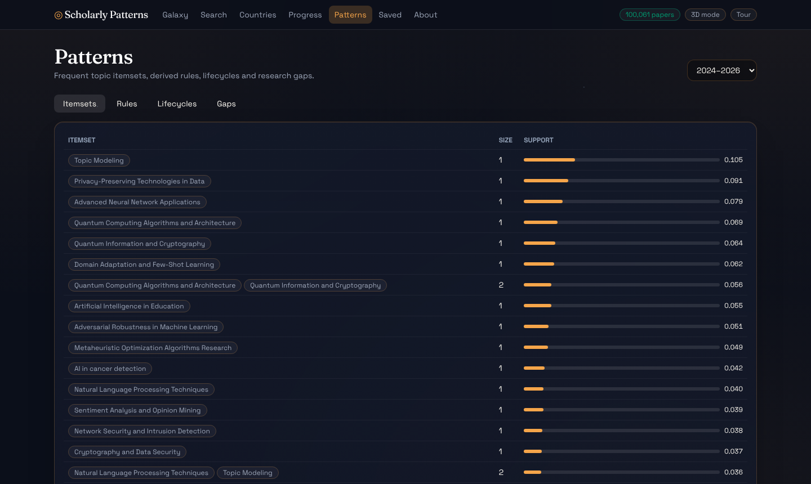
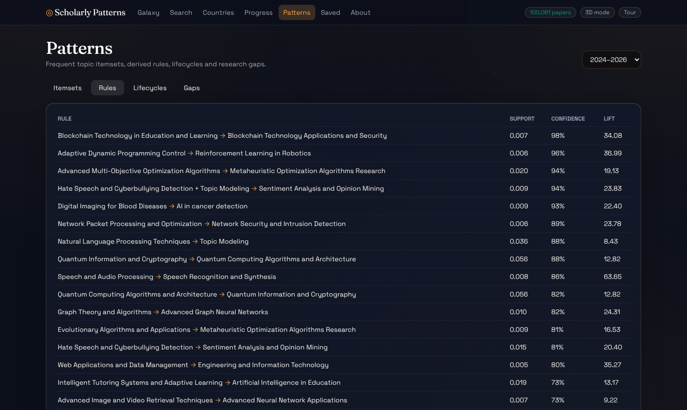
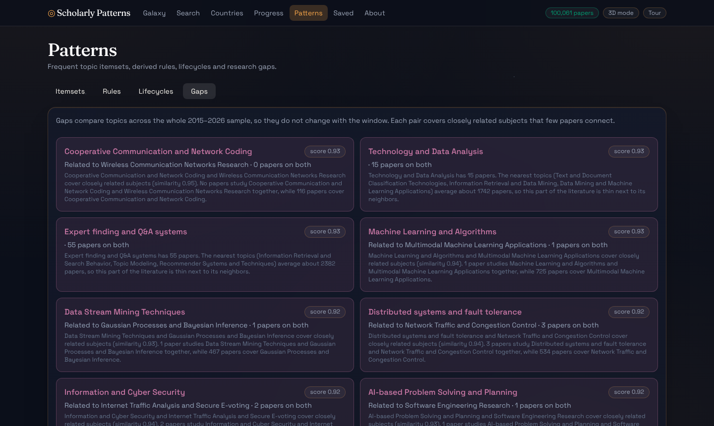

# Scholarly Pattern Explorer

Explore computer-science research by meaning instead of keywords. About 100,000
papers (2015 to Oct 2026) from OpenAlex are embedded, placed on an interactive
galaxy, and mined for topic combinations that are emerging, fading, or missing.

**Live site:** https://scholarly-pattern-explorer.vercel.app



Each dot is a paper. Papers that share ideas sit close together, and colours mark
topic clusters. Hover a dot to read the paper; search by meaning ("protein folding")
rather than exact words.

## What you can do

| Page | What it shows |
|---|---|
| Galaxy | 2D and 3D map of the papers, semantic search, highlighted research gaps |
| Countries | Who publishes what: shared, split and full credit counting, a globe with collaboration arcs, per-country specialised topics |
| Patterns | Frequent topic itemsets, association rules, pattern lifecycles, research gaps |
| Progress | What each data load added |
| Saved | Papers you keep |

| | |
|---|---|
|  |  |
|  |  |

## How the patterns work

- Each paper is a basket of OpenAlex topics. FP-Growth finds topic sets that appear
  together often. **Size** is the number of topics in the set; **support** is the
  share of papers in the window that contain all of them.
- Windows are 3 years wide and step by 1 year (2015-2017 up to 2024-2026).
- **Rules** (A → B) come from the itemsets: confidence = support(A∪B) / support(A),
  lift = confidence / support(B).
- **Born / died:** a pattern is born in the first window where it appears and dies
  the first window after its last appearance. They change when windows are re-mined
  or a new window completes, not with every monthly update.
- **Gaps** are computer-science topics that are growing but small, or closely related
  topic pairs that few papers connect.

## Architecture

- `apps/web`: Next.js front end (Vercel)
- `apps/api`: FastAPI service (Render, free tier)
- `ml/`: embeddings, pattern mining, gaps, emerging topics, search
- `pipeline/`: OpenAlex ingest and country statistics
- Supabase Postgres with pgvector stores papers and embeddings
- GitHub Actions run a keep-alive ping and a monthly data update

## Run it locally

```bash
# web
cd apps/web && npm install && npm run dev      # http://localhost:3000
# api
cd apps/api && pip install -r requirements.txt && uvicorn app.main:app --reload
# tests
cd apps/web && npm test
cd apps/api && pytest
python -m pytest ml
```

## More

- [Project status](docs/STATUS.md) and [handover](docs/HANDOVER.md)
- [Original prototype README](docs/PROTOTYPE.md): the first version, a Streamlit
  dashboard over Canadian and AI corpora. Its screenshots live in `screenshots/`.

Data: [OpenAlex](https://openalex.org). Licence: see `LICENSE`.
