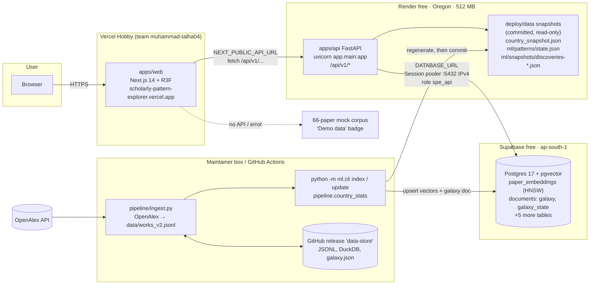

# Scholarly Pattern Explorer — Handover Report

**Repository:** `muhammad-talha04/scholarly-pattern-explorer` (branch `main`, head `b8eb642a`, PR #26)
**Prepared:** 16 Oct 2026 (PKT, UTC+5) for the team that will upgrade the project next. **Updated** the same day (~12:00 PKT) with §11, the external council review.
**Live site:** https://scholarly-pattern-explorer.vercel.app · **Live API:** https://scholarly-pattern-explorer.onrender.com

> **How this report was checked.** Facts come from the repository at `main` (`b8eb642a`): README, `docs/STATUS.md` and its git history, `apps/web`, `apps/api`, `ml/`, `pipeline/`, `db/migrations`, `render.yaml`, `deploy/data`, the tests and the CI workflows. The PR list #1–#26 came from the GitHub connector. They also come from the deployment notes the maintainer supplied. Live checks were run on 16 Oct 2026: API smoke calls, and read-only Supabase queries for size, settings and table list. Anything that could not be checked is marked **[unverified]**. No secret values appear anywhere in this document.

---

## Contents

1. [Executive summary](#1-executive-summary)
2. [Architecture](#2-architecture)
3. [Components and file map](#3-components-and-file-map)
4. [Environment and configuration reference](#4-environment-and-configuration-reference)
5. [Deployment runbook](#5-deployment-runbook)
6. [Data pipeline](#6-data-pipeline)
7. [Timeline of work and PR table](#7-timeline-of-work-and-pr-table)
8. [Errors encountered and fixes](#8-errors-encountered-and-fixes)
9. [Known limitations](#9-known-limitations)
10. [Scaling plan: 75,000 papers](#10-scaling-plan-75000-papers)
11. [External review (council) — issues and solutions](#11-external-review-council--issues-and-solutions)
12. [Do / Don't](#12-do--dont)
13. [Recommended next steps](#13-recommended-next-steps)
14. [Appendix: verification log](#14-appendix-verification-log)

---

## 1. Executive summary

Scholarly Pattern Explorer v2 is a free web app for exploring AI research papers from OpenAlex. Users can search papers by meaning, read summaries, ask questions about a paper, and see emerging topic patterns, country analytics and research gaps. It sits next to the original v1 Streamlit/DuckDB pattern miner, which still lives at the repo root and still runs on its own GitHub Actions schedule.

**State on 16 Oct 2026**

| Item | State |
|---|---|
| Front end | Next.js 14 + React Three Fiber in `apps/web`, Vercel Hobby, auto-deploys from `main`. Live. |
| API | FastAPI in `apps/api` on Render free (Oregon, 512 MB RAM). Live, `/api/v1/health` returns 200, `/api/v1/stats` returns `{"papers":14159}`. |
| Database | Supabase free (`ap-south-1`), Postgres 17.11 + pgvector 0.8.2, 7 tables. Size is **89 MB** today (91 MB was logged on 15 Oct). The free-plan limit is 500 MB. |
| Corpus | **14,159** unique OpenAlex AI-subfield articles (subfield 1702, type article, published since 2024-10-15), with 384-dim **hash** embeddings. |
| Precomputed data | The galaxy graph lives in the DB (14,159 nodes, 9 clusters, 200 links). Country, pattern and discovery snapshots are committed under `deploy/data/` (~6.8 MB). |
| CI | `tests` and `api` workflows are green on `main` (runs on 15 Oct after #26). |
| Open PRs | #16, #19, #20, #21 (see §7). Nothing after #27 as of 16 Oct ~12:00 PKT. |
| External review | Council score **67/100** (revised from 65). Data trust is weakest (13/25). See §11. |
| `v2 ingest` workflow | **Enabled.** Next run 1 Nov 2026 08:00 PKT. The council says **pause it now** (§11.5, item 1). |

**Where to start:** read §2 and §5, then §9, §11 (external review) and §12. Before you add any data, read §10. The biggest traps are these:

- the 500 MB Supabase limit;
- the 512 MB Render RAM, where anything that loads every vector or a large JSON document will crash the instance;
- snapshots in `deploy/data/` that are frozen at 14,159 papers;
- the embedder must match: `ML_EMBEDDER=hash` everywhere, or re-embed everything;
- the still-enabled 1 Nov ingest job, which would mix embeddings;
- the misleading growth figures and unlabelled corpus scope found by the council (§11).

**First three actions:** pause the job, fix the growth metric, label the data (§11.5).

---

## 2. Architecture



**Request flow.** The browser loads the Vercel app. Client code calls `${NEXT_PUBLIC_API_URL}/api/v1/...`. The API reads the following:

- vectors and the stored galaxy document from Supabase, through one long-lived psycopg connection made by `ml/store.py:PgVectorStore`;
- country, pattern, run and discovery data from the committed snapshot files in `deploy/data/`. `ml/paths.py` falls back to these when `RENDER=true`.

If the API is unset or unreachable, the web client serves its built-in 66-paper mock and shows a "Demo data" badge.

**Write flow (offline).** Nothing writes to the DB from Render. Ingestion and indexing run on a machine outside Render: the maintainer box, or GitHub Actions for the file-backend path. That machine then upserts into Supabase, regenerates `deploy/data/`, and commits it.

---

## 3. Components and file map

### 3.1 Repository layout

| Path | What it is | Notes |
|---|---|---|
| `apps/web/` | Next.js 14 front end (React 18, three 0.169, @react-three/fiber 8, drei, postprocessing, framer-motion, Tailwind) | Vercel root directory. Scripts: `dev`, `build`, `lint`, `typecheck`, `test` (vitest). |
| `apps/web/src/lib/api/client.ts` | API client. Reads `NEXT_PUBLIC_API_URL`, `NEXT_PUBLIC_API_MOCK`, `NEXT_PUBLIC_SEARCH_LIMIT`, `NEXT_PUBLIC_GALAXY_LIMIT`. `normalizeGalaxy` accepts both galaxy payload shapes. | Falls back to `mock.ts` per route. |
| `apps/web/src/lib/api/mock.ts` | 66-paper sample (`FIXTURE_COUNT`) | Source of the "Demo data" badge (`components/SourceBadge.tsx`). |
| `apps/web/src/lib/palette.ts` | **Every colour in the app** (Champagne & Platinum): ink `#121216`, accent `#F3E3B5`, cluster tones champagne gold / platinum / antique gold / pewter / pale gold, Okabe–Ito for charts. | Change colours here only. |
| `apps/web/src/lib/theme.ts` | CSS variables and `clusterColors` (Champagne & Platinum row in STATUS) | |
| `apps/web/src/lib/paperLink.ts` | Paper links. Since #22 the fake `10.1234` DOIs are gone; demo papers show "Find on OpenAlex". | |
| `apps/web/src/features/galaxy/` | `GalaxyHero.tsx` (landing), `Galaxy3D.tsx` (instanced spheres, contact shadow, hover lock on stable instance ids), `stars.ts`, `hover.ts`, `layout.ts` | Up to 600 papers. Reduced motion and low power hold the 3D view still. There is no 2D galaxy. |
| `apps/web/src/features/{search,countries,timeline,patterns,compare,collections}/` | Pages: search + paper panel + ask chat, 3D/2D globe with counting toggle, streamgraph timeline, patterns, compare tray, localStorage collections | |
| `apps/web/src/__tests__/` | 12 vitest files | CI job `web` in `test.yml`. |
| `apps/api/app/main.py` | FastAPI app, CORS `*`, router at `/api/v1` | |
| `apps/api/app/routers/core.py` | All routes: `/health`, `/stats`, `/search`, `/papers/{id}`, `/papers/{id}/ask` (POST), `/papers/{id}/related`, `/papers/{id}/similar`, `/patterns` (`trend=gap` or `trend=emerging`), `/countries`, `/countries/collaborations`, `/countries/{code}`, `/galaxy`, `/topic-country-years`, `/runs` | `GALAXY_NODE_LIMIT` is applied here, after the whole document is loaded. |
| `apps/api/app/ml_bridge.py` | Glue to `ml/`. `get_semantic_gaps` reads the newest `discoveries-*.json` first (#26). | |
| `apps/api/app/schemas.py` | Pydantic response models (API contract) | |
| `apps/api/requirements.txt` | fastapi, uvicorn[standard], pydantic, numpy, **psycopg[binary]** (#23), pytest, httpx | No sentence-transformers, so `ML_EMBEDDER=hash` is required on Render. |
| `ml/` | Embeddings (`embeddings.py`, hash or MiniLM), store (`store.py`, LocalStore / PgVectorStore), galaxy layout (`galaxy.py`), search/summaries/ask (`service.py`, `llm.py`), incremental FP-Growth mining (`incremental.py`), gaps/emerging (`gaps.py`, `research_gaps.py`, `emerging.py`, `discover.py`), CLI (`cli.py`: `index`, `update`, `galaxy`, `discover`), paths (`paths.py`) | `ml/requirements.txt` includes sentence-transformers + CPU torch and is meant for indexing machines, not Render. |
| `ml/paths.py` | Repo-root-anchored paths. When the env var is unset and `data/` is missing, falls back to `deploy/data/` if `RENDER` is set, or `SPE_DEPLOY_SNAPSHOTS=1`. `SPE_DEPLOY_SNAPSHOTS=0` disables. | Applies to `ML_DATA_DIR` and `COUNTRY_SNAPSHOT`, **not** `TOPIC_COUNTRY_YEAR_DB`. |
| `ml/galaxy.py` | PCA-3 layout with a frozen basis, k-means (or UMAP+HDBSCAN if installed), c-TF-IDF labels, `LINK_NEIGHBOURS = 2`, `LINK_CAP = 200` | 200 is an edge cap, not a paper cap. |
| `pipeline/ingest.py` | Incremental OpenAlex fetch (cursor paging, `per-page=200`, retries, saves each page, dedupe by work id in JSONL) | Default filter `primary_topic.subfield.id:subfields/1702`, `type:article`. |
| `pipeline/country_stats.py`, `country_api.py` | Country snapshot + topic×country×year aggregate; serving logic for `/countries*` | Fractional counting by default. |
| `db/migrations/001–004*.sql`, `db/apply.py` | Idempotent DDL. `PgVectorStore` also runs every migration **on each connect**. | See §6.4. |
| `deploy/data/` | Committed snapshots (§6.5) | Frozen at 14,159 papers. |
| `render.yaml` | Render blueprint (free plan, build/start/health, `sync:false` env keys) | No secret values. |
| `tests/integration/` | 42 cross-package contract tests | |
| `eval/` | Search qrels (40 queries), benchmark CSV, `score_search.py`, `pattern_stability.py` | |
| `docs/STATUS.md` | **Team log. Every change must be recorded here.** | |
| `docs/architecture/` | `README.md` (contract), `STORAGE.md`, `WORKFLOW.md` | |
| Repo root `*.py`, `*.ps1` | v1 Streamlit pattern miner (`app.py`, `fetch_openalex.py`, `build_db.py`, `mine_windows.py`, `linkpred.py` …) | Root `requirements.txt` is v1 (streamlit, torch, gensim). **Never use it for the API.** |

### 3.2 Database (Supabase, 7 tables, all with RLS on and no policies)

| Table | Migration | Content | State 16 Oct |
|---|---|---|---|
| `paper_embeddings` | 001 | `work_id` PK, `embedding vector(384)`, `meta` jsonb, `model`. HNSW index `paper_embeddings_hnsw` (cosine) | 14,159 rows. Heap 19 MB, TOAST+PK ~28 MB, HNSW 28 MB (75 MB total). |
| `documents` | 001 | `kind` PK, `payload` jsonb | 2 rows: `galaxy` (~1.8 MB stored), `galaxy_state` (~0.7 MB) |
| `topic_country_year` (+ view `topic_country_year_v`) | 002 | topic × country × year counts | Not used by the live API; served from snapshot [row count not checked] |
| `discovery_snapshots` | 003 | gap/emerging runs | Unused until #16 lands |
| `runs`, `paper_summaries`, `snapshots` | 004 | run log, summary cache, per-run snapshots | `runs` has **0 rows**. `/runs` comes from miner state. |

The role is `spe_api`. It owns the tables, so it bypasses RLS while anon/authenticated see nothing. Its `search_path` is `public, extensions`, and `vector` is in the `extensions` schema. DB settings read on 16 Oct: `maintenance_work_mem` 32 MB, `work_mem` ~2 MB, `shared_buffers` 224 MB, `max_connections` 60.

---

## 4. Environment and configuration reference

**Key names only. No values are recorded here.**

- `DATABASE_URL` is in the **Render service environment** and in **a private file on the maintainer's box**. It is never in the repo, never in GitHub secrets (checked 16 Oct: repo secrets are only `OPENALEX_API_KEY` and `OPENALEX_MAILTO`), and never in chat.

### 4.1 Render (API service `srv-db8gnru7bikc73e2r0p0`)

| Key | Set in production? | Purpose |
|---|---|---|
| `PYTHON_VERSION` | Yes (`3.11.11`, in blueprint) | Matches CI |
| `ML_EMBEDDER` | Yes (`hash`) | Must match the embedder used to index. sentence-transformers is not installed on Render. |
| `DATABASE_URL` | Yes (secret) | Supabase **Session pooler** URI, port 5432, user `spe_api.<project-ref>` |
| `RENDER` | Set by Render automatically | Turns on the `deploy/data` snapshot fallback |
| `SPE_DEPLOY_SNAPSHOTS` | No | `1`/`0` forces the fallback on or off |
| `GALAXY_NODE_LIMIT` | **No (unset)** | Read-time cap on `/galaxy` nodes |
| `SEARCH_MAX_LIMIT` | No (default 100) | Max hits one search ranks |
| `ML_VECTOR_BACKEND` | No | `local` / `pgvector` override |
| `ML_EMBED_MODEL`, `ML_DATA_DIR`, `ML_WORKS_PATH`, `COUNTRY_SNAPSHOT`, `TOPIC_COUNTRY_YEAR_DB` | No | Path/model overrides |
| `ML_LLM_URL`, `ML_LLM_MODEL`, `ML_LLM_API_KEY` | No | Optional OpenAI-compatible LLM. Unset uses extractive summaries. |
| `OPENALEX_API_KEY`, `OPENALEX_MAILTO` | Not needed by the API at runtime | Ingestion only |

### 4.2 Vercel (project `scholarly-pattern-explorer`, team `muhammad-talha04`, root `apps/web`)

| Key | Production | Purpose |
|---|---|---|
| `NEXT_PUBLIC_API_URL` | `https://scholarly-pattern-explorer.onrender.com` (**no `/api/v1`**) | API origin. Empty means mock. |
| `NEXT_PUBLIC_API_MOCK` | **Unset** | `1` forces the mock |
| `NEXT_PUBLIC_SEARCH_LIMIT` | Unset (20) | Search page size |
| `NEXT_PUBLIC_GALAXY_LIMIT` | Unset | Optional `?limit=` on `/galaxy` |

`NEXT_PUBLIC_*` values are baked in at build time, so changing one requires a redeploy.

### 4.3 GitHub Actions secrets

`OPENALEX_API_KEY`, `OPENALEX_MAILTO`. `DATABASE_URL` is intentionally **not** a repo secret. Read §12 before adding it.

### 4.4 Ingestion machine (maintainer box)

`DATABASE_URL` (from the private file), `ML_EMBEDDER=hash`, `OPENALEX_API_KEY`, `OPENALEX_MAILTO`, and optionally `ML_VECTOR_BACKEND=pgvector`.

---

## 5. Deployment runbook

### 5.1 Vercel (front end)

1. Project `scholarly-pattern-explorer` under team `muhammad-talha04`, framework Next.js, **Root Directory `apps/web`**. Git integration with this repo makes every push to `main` deploy production and every PR get a preview.
2. Env: set `NEXT_PUBLIC_API_URL` to the Render origin with no trailing `/api/v1`. Leave `NEXT_PUBLIC_API_MOCK` unset. Redeploy after any env change.
3. Verify: open the site. The nav paper count should read 14,159 (from `/api/v1/stats`) and the "Demo data" badge should be **absent**. If the badge shows, the API was unreachable. Render may be cold-starting (~50 s), so reload.
4. If the Vercel MCP connector returns "no teams" or "User not found", use the Vercel dashboard in a browser (that is what worked). If you land on Vercel's **"Create GitHub App"** page, **cancel**: the existing Git integration is enough.

### 5.2 Render (API)

1. New Web Service from this repo (or Blueprint from `render.yaml`). Runtime Python, plan Free, region Oregon. **Root directory = repo root**, because the API imports `ml/` and `pipeline/`.
2. **Build command:** `pip install -r apps/api/requirements.txt`. Make sure it is not left at the default, which installs the v1 root `requirements.txt`.
3. **Start command:** `uvicorn app.main:app --app-dir apps/api --host 0.0.0.0 --port $PORT`
4. **Health check path:** `/api/v1/health`
5. Env: `PYTHON_VERSION=3.11.11`, `ML_EMBEDDER=hash`, `DATABASE_URL` (secret, see 5.3).
6. A card is required even on the free tier ($1 verification hold).
7. Verify:
   - `GET /api/v1/health` returns `{"status":"ok"}`.
   - `GET /api/v1/stats` returns `{"papers":14159}`.
   - `/api/v1/countries`, `/api/v1/patterns`, `/api/v1/patterns?trend=gap` and `/api/v1/runs` are non-empty.
   - `/api/v1/galaxy` returns 14,159 nodes.
8. The free instance spins down when idle. The first request after idle takes ~50 s.

### 5.3 Supabase (database)

1. Project `scholarly-pattern-explorer`, ref `obhzpotvdexzkaeheiun`, region `ap-south-1`, free plan.
2. Schema: `python -m db.apply` with `DATABASE_URL` set. This applies `db/migrations/001–004` in order and is idempotent. `PgVectorStore` also re-runs them on every connect.
3. Role `spe_api` is the login role that owns all tables, with `search_path = public, extensions`. Create it once as `postgres` and grant schema usage, then let it create the tables. **[unverified: exact role-creation SQL is not in the repo]**
4. Connection string: **always copy it from Supabase → Connect → Session pooler**. Do not hand-build the host. The working pooler host is `aws-0-ap-south-1.pooler.supabase.com`, port **5432** (Session mode, IPv4). Guessing `aws-1-…` failed with `FATAL (ENOTFOUND) tenant/user … not found`. The direct `db.<ref>.supabase.co` host is IPv6-only on free projects **[per Supabase docs, not re-tested]**. Render needs the IPv4 pooler.
5. Store the URI only in the Render env and in the maintainer's private file.
6. Monitor size with `SELECT pg_size_pretty(pg_database_size(current_database()));`. The free limit is 500 MB.

### 5.4 Redeploy checklist after a data change

1. Upsert vectors and documents into Supabase (§6).
2. Regenerate `deploy/data/` (§6.5) and commit it via PR (squash-merge after checks).
3. Render auto-deploys from `main` **[unverified: auto-deploy setting not inspected]**. Otherwise use Manual Deploy → "Deploy latest commit".
4. Smoke-test the endpoints in 5.2, step 7.
5. Log the change in `docs/STATUS.md`.

---

## 6. Data pipeline

### 6.1 Ingestion — `pipeline/ingest.py`

- Calls `GET https://api.openalex.org/works` with filter `from_publication_date:<since>,type:article,primary_topic.subfield.id:subfields/1702` (extra `--filter` values are **appended** to the default), `per-page=200`, `select=…`, and cursor paging (`cursor=*` → `meta.next_cursor`).
- Sends `mailto` and `api_key` from `OPENALEX_MAILTO` / `OPENALEX_API_KEY` when set. Retries up to 6× with exponential backoff, and exits on 401/403. Sleeps 0.15 s between pages.
- Every 200 records it calls `merge()`, which appends only work ids not already in the JSONL (dedupe by `id`). On failure it keeps what it has and does **not** advance `last_run`.
- State lives in `--state` (default `data/ingest_state.json`, `{"last_run", "last_added"}`). With no state file, `since = today − --first-lookback-days`. Otherwise `since = last_run − --overlap-days` (7).
- `--max-records` defaults to 50,000.
- No `--until` flag exists. Bound a backfill with `--filter to_publication_date:YYYY-MM-DD` and a separate `--state` file.

### 6.2 Indexing — `python -m ml.cli index`

- Reads the works JSONL (`ML_WORKS_PATH`, `data/works_v2.jsonl` or `--jsonl`). Embeds title+abstract in batches of 64. Upserts into `paper_embeddings` **one row per `INSERT … ON CONFLICT (work_id) DO UPDATE` statement** (autocommit). It **re-embeds and re-upserts every paper in the file on every run**; there is no skip-existing.
- Then `rebuild_galaxy()` calls `store.rows()`, which loads **every vector and meta** into memory. It syncs the layout, builds the graph and writes the `galaxy_state` and `galaxy` documents.
- `ML_EMBEDDER=hash` gives 384-dim hashed bag-of-words vectors (free, no model). Unset means sentence-transformers `all-MiniLM-L6-v2` (384-dim, same column width, **different vector space**).

### 6.3 Analytics — `python -m pipeline.country_stats` and `python -m ml.cli update`

- `country_stats --new works_v2.jsonl` builds `country_snapshot.json`: countries, collaborations in 3 counting modes, topic×country×year rows. At 14,159 papers this was 135 countries, 1,177 topics and 18,115 topic-country-year rows.
- `ml.cli update` runs incremental FP-Growth over 3-year windows (pattern `state.json`, a dated pattern snapshot), then `refresh_discoveries` (`discoveries-<date>.json`: emerging topics + semantic gaps), then a galaxy rebuild. Result on 15 Oct: run 1, 14,159 papers, 66 patterns changed, windows 2022–2026, 20 emerging topics, 10 semantic gaps.

### 6.4 How the 14,159 papers were loaded (15 Oct 2026)

1. 3,000 works first: `python -m pipeline.ingest --max-records 3000` (articles since 2025-10-15), then `python -m ml.cli index` with `ML_EMBEDDER=hash`. DB size 28 MB.
2. Expansion: `python -m pipeline.ingest --first-lookback-days 730 --max-records 12000` (since 2024-10-15), merged to **14,159 unique** works, then re-indexed.
3. The maintainer box **could not open outbound ports 5432/6543**, so rows were loaded through the **Supabase MCP** `execute_sql` in batches (SQL batch files of ~2 MB each). The galaxy document was too big for one call, so it went through a **temporary staging table** and was then upserted into `documents`.
4. DB size went from 28 MB to 91 MB. That is ~63 MB for ~11,159 extra papers, **≈5.6 KB per paper**, including the HNSW index and JSONB metadata.

### 6.5 Committed snapshots — `deploy/data/` (PR #25)

| File | Size | Built by |
|---|---|---|
| `country_snapshot.json` | 5.0 MB | `pipeline.country_stats` |
| `ml/patterns/state.json` | 2.06 MB | `ml.cli update` |
| `ml/patterns/snapshots/2026-10-15.json` | 1.3 KB | `ml.cli update` |
| `ml/snapshots/discoveries-2026-10-15.json` | 19 KB | `ml.cli update` / `discover` |

These exist because `data/` is gitignored and Render's disk is ephemeral. Before #25, Countries, Progress and Patterns were empty on Render. **They do not update themselves.** Regenerate and recommit them whenever the corpus changes.

### 6.6 Scheduled workflows (GitHub Actions)

| Workflow | Trigger | What it does | Notes |
|---|---|---|---|
| `tests` (`test.yml`) | push, PR | v1 FP-Growth/link-pred checks, synthetic pipeline, `ML_EMBEDDER=hash pytest ml`, integration tests, plus a `web` job: `npm ci`, lint, typecheck, vitest, `next build` | The required check for merges |
| `api` (`api.yml`) | push/PR touching `apps/api/**` | `pytest` in `apps/api` | |
| `v2 ingest` (`v2-ingest.yml`) | cron `0 3 1,15 * *` (08:00 PKT on the 1st and 15th), manual, push to `pipeline/**` (tests only) | Restores `works_v2.jsonl`/state/snapshot from release `data-store`, runs ingest and `country_stats`, uploads back, then `pip install -r ml/requirements.txt` and `ml.cli index` + `update`, then uploads `galaxy.json` | Uses the **file backend** (no `DATABASE_URL` secret) and does **not** set `ML_EMBEDDER=hash`. The 15 Oct scheduled run succeeded (59 min). It does **not** touch Supabase or `deploy/data/`. Next run: 1 Nov 2026 08:00 PKT. |
| `Daily data fetch`, `Weekly re-mine and publish` | daily 03:00 UTC / Sundays 04:00 UTC | v1 Streamlit corpora (DuckDB on the release, snapshot under `docs/`) | Independent of v2 |

Release `data-store` assets (16 Oct): `works_v2.jsonl` 515 MB, `galaxy.json` 16.6 MB, `country_snapshot.json` 8.3 MB, plus the v1 DuckDB/JSONL files. **[unverified: how many works the release `works_v2.jsonl` holds and whether it matches the 14,159 in Supabase. It was written by the scheduled run, not by the load in §6.4.]**

---

## 7. Timeline of work and PR table

All times are PKT (UTC+5). Merges #1–#17 used merge commits; from #18 on, PRs were squash-merged.

**14 Oct 2026.** `olli` added the workflow design and `docs/STATUS.md` (22:24 PKT). PRs #1–#3 were opened at about 23:18 PKT.

**15 Oct, morning (07:25–12:26):** the platform, ML, pipeline, tests, front end v3 and storage were merged. #16 got stuck because the bot token lacks the `workflow` permission.

**15 Oct, evening (21:00–23:40):** the landing galaxy redesign shipped. Then the deploy and data work: Vercel live, Render created, Supabase loaded with 3k and then 14k papers, the psycopg fix, committed snapshots, and the gap-endpoint OOM fix.

| PR | Title | Branch | State | Merged (PKT) | Summary |
|---|---|---|---|---|---|
| #1 | v2 platform skeleton and API contract | `platform-skeleton` | merged | 15 Oct 07:25 | FastAPI skeleton, `/api/v1` contract, schemas (olli) |
| #2 | ML service: semantic search, summaries, paper chat, incremental patterns | `ml-service` | merged | 15 Oct 08:24 | `ml/` package (tom, michal gap finder) |
| #3 | v2: incremental OpenAlex ingestion and country analytics | `data-pipeline` | merged | 15 Oct 07:26 | `pipeline/` (grok) |
| #4 | Cross-PR integration tests | `integration-tests` | merged | 15 Oct 08:32 | `tests/integration`, 42 tests (ami) |
| #5 | Web front end (Release 1) | `web-frontend` | **closed, not merged** | — | Superseded by #11 |
| #6 | Country counts and topic-country-year aggregate | `cursor/country-fractional-aggregate-2d35` | merged | 15 Oct 09:35 | Fractional counts, migration 002 |
| #7 | Anchor data paths to the repo root | `fix/anchor-data-paths` | merged | 15 Oct 08:33 | `ml/paths.py` |
| #8 | Embedding benchmark and stable paper galaxy | `cursor/embed-benchmark-galaxy-a2c6` | merged | 15 Oct 09:38 | MiniLM vs bge/e5 benchmark, frozen PCA galaxy |
| #9 | Research gaps, similar papers, and emerging topics | `cursor/gaps-similar-emerging-4506` | merged | 15 Oct 09:46 | Semantic gaps, `/similar`, emerging |
| #10 | Add search qrels, pattern stability, and a feature shortlist | `cursor/search-eval-qrels-e0da` | merged | 15 Oct 09:48 | `eval/` |
| #11 | UI v3: polished front end on live data | `cursor/ui-v3-polished-frontend-024d` | merged | 15 Oct 12:24 | Front end v3 (harry) |
| #12 | STATUS: coherent 'Where we left off' after merges | `docs/status-cleanup` | merged | 15 Oct 09:59 | Docs |
| #13 | Cap topic-country-years limit | `cursor/topic-country-year-limit-2d35` | merged | 15 Oct 11:59 | Limit clamp 1–10000 |
| #14 | Note OpenAlex free API key for bulk access | `cursor/openalex-api-key-note-5e73` | merged | 15 Oct 12:02 | Docs |
| #15 | Galaxy graph payload and shared pgvector storage | `cursor/galaxy-graph-storage-a2c6` | merged | 15 Oct 12:06 | `{nodes,clusters,links}`, `documents` table, migrations 001–004 |
| #16 | Read gaps and emerging topics from the discoveries snapshot | `cursor/precomputed-discoveries-4506` | **open** | — | Blocked: touches `v2-ingest.yml`, and the bot token lacks the `workflow` scope |
| #17 | STATUS: record #11, #13, #14, #15 merges and #16 blocker | `docs/status-v3` | merged | 15 Oct 12:26 | Docs |
| #18 | Embedding Lens landing galaxy | `cursor/galaxy-paper-copy-024d` | merged | 15 Oct 21:00 | Plexus redesign (§7.1) |
| #19 | Route topic-country-year through the shared store | `cursor/topic-country-year-storage-2d35` | **open** | — | Postgres `topic_country_year` read/write |
| #20 | Stable galaxy colours and incremental topic labels | `cursor/stable-cluster-identity-a2c6` | **open** | — | `color_index`, Hungarian matching |
| #21 | Add a colour-keyed emerging score to galaxy clusters | `cursor/galaxy-emerging-score-4506` | **open** | — | Depends on #20 |
| #22 | Stop fake DOI links and mark demo data | `cursor/demo-data-and-render-024d` | merged | 15 Oct 22:08 | "Find on OpenAlex" links, Demo data badge, `render.yaml` |
| #23 | Add psycopg to API requirements and log Supabase data load | `api-postgres-driver` | merged | 15 Oct 22:57 | `psycopg[binary]>=3.1` |
| #24 | Log 14k-paper Supabase load in STATUS | `data-14k` | merged | 15 Oct 23:16 | Docs |
| #25 | Serve committed country and pattern snapshots on ephemeral deploys | `live-snapshots` | merged | 15 Oct 23:34 | `deploy/data/`, `ml/paths.py` fallback (first CI run failed and was fixed before merge) |
| #26 | Read semantic gaps from the discoveries snapshot | `gaps-from-snapshot` | merged | 15 Oct 23:40 | OOM fix for `/patterns?trend=gap` |

### 7.1 Galaxy design (PR #18) — what was accepted and rejected

Superseded on 2026-10-22: the landing galaxy is 3D only, in the Champagne & Platinum palette, with up to 600 papers and a hover lock. The 2D canvas and the plexus band below are no longer in the app. See `docs/STATUS.md`.

- **Accepted (historical, PR #18):** a low-poly plexus of about **310 tiny instanced nodes** (`PLEXUS_COUNT`) in one diagonal band.
  - Colours run **copper `#C2410C` → amber `#F5A54A` → pale gold `#FDE7B0`** on navy **`#0B0F1A`**.
  - Each node links to at most 6 near neighbours, and line opacity fades with length.
  - Motion is **1.5×** the first plexus: drift, twinkle and a **continuous circular yaw** with a small tilt.
  - A **14 s breathing zoom** goes from ~38% to ~81% of the viewport width: 547 px → 1,173 px at 1440 px.
  - There is no scroll-wheel zoom. Motion **pauses when the tab is hidden** and is **static under `prefers-reduced-motion`**.
  - A **2D canvas fallback** exists, and `?plexus=in|out` freezes the poses.
  - Palette: `apps/web/src/lib/palette.ts`.
- **Rejected iterations — do not reintroduce:**
  - the thick, bright "neuron/filament strand" look;
  - oversized nodes.
- The hero draws its 310 plexus dots from the papers it receives, but it fetches the **whole** `/galaxy` payload to do so (see §9).

---

## 8. Errors encountered and fixes

| # | Symptom | Cause | Fix / lesson |
|---|---|---|---|
| 1 | Vercel MCP connector returned no teams / "User not found", even after re-auth | Connector/account mismatch **[root cause unverified]** | Deployed through a browser sign-in on the Vercel dashboard |
| 2 | User landed on Vercel's "Create GitHub App" page | Wrong flow in onboarding | Cancel it. The existing Git integration is enough. |
| 3 | Render demanded a card on the free tier | Render policy ($1 verification hold) | Card added. Budget for it. |
| 4 | First Render build: `ModuleNotFoundError: fastapi` | Build Command left at default, which installed the root v1 `requirements.txt` (streamlit/torch) | Build command `pip install -r apps/api/requirements.txt` |
| 5 | Site showed 0 papers | Supabase DB was empty | Loaded 3,000 and then 14,159 papers (§6.4) |
| 6 | API failed on first store call | `psycopg` missing from API requirements | PR #23 added `psycopg[binary]>=3.1` |
| 7 | `FATAL (ENOTFOUND) tenant/user … not found` | Pooler host guessed as `aws-1-ap-south-1…` | Use `aws-0-ap-south-1.pooler.supabase.com`. Always copy it from Supabase → Connect → Session pooler. |
| 8 | Countries / Progress / Patterns empty on Render | `data/` is gitignored and Render's disk is ephemeral | PR #25: committed snapshots under `deploy/data/` + `ml/paths.py` fallback |
| 9 | `/patterns?trend=gap` gave HTTP 502, instance restarted | Semantic gaps computed live by loading all 14,159 vectors exhausted 512 MB | PR #26: read `semantic_gaps` from the newest discoveries snapshot |
| — | Maintainer box could not reach ports 5432/6543 | Outbound network restriction on that box | Loaded via the Supabase MCP in ~2 MB batches. Galaxy document via a temp staging table. |
| — | PR #16 push refused | Bot token lacks `workflow` permission (it edits `.github/workflows/`) | Still open. The owner must push with a token that has Workflows read/write. |

---

## 9. Known limitations

1. **Snapshots are frozen at 14,159 papers.** `deploy/data/` must be regenerated and recommitted after every data change. Until then, `/countries`, `/patterns`, `/runs` and gaps disagree with `/stats` and `/search`.
2. **`growth_pct` shows large negatives** because 2026 is a partial year compared against full years. The council found −80% to −98% for ~90% of countries, and huge positives on tiny bases (§11.3, C1–C2).
3. **Sparse galaxy links.** `LINK_NEIGHBOURS = 2`, `LINK_CAP = 200`, so there are only 200 edges across 14,159 nodes.
4. **Single long-lived psycopg connection.** `PgVectorStore` opens one autocommit connection and never reconnects. If the pooler drops it while idle, requests can fail until the process restarts **[failure mode inferred from the code, not reproduced]**.
5. **Migrations run on every connect.** Each process start executes all DDL in `db/migrations`. That is harmless but slower, and it requires the owner role.
6. **`/runs` comes from miner state** (`deploy/data/ml/patterns/state.json`), not from the DB `runs` table (0 rows).
7. **`GALAXY_NODE_LIMIT` is unset**, so `/galaxy` returns the full graph: 4,427,450 bytes measured on 16 Oct (~4.4 MB; STATUS says ~4.7 MB). The landing page downloads all of it to draw 310 dots.
8. **`GALAXY_NODE_LIMIT` is a read-time prefix cap, not a sample.** The route loads the entire `galaxy` document from Postgres, then keeps the first N nodes in stored order and drops links whose endpoints fall outside. It does not reduce DB reads or server memory, and it is not representative.
9. **Hash embedder.** Chosen for the free tier (no model download, fits 512 MB). Semantic quality is lower than MiniLM. Switching means re-embedding every row and installing sentence-transformers where queries are encoded.
10. **Indexing is not incremental.** `ml.cli index` re-embeds and re-upserts the whole JSONL, one SQL statement per row, and `rebuild_galaxy` loads every vector into memory.
11. **Scale of the field.** All OpenAlex CS articles since 2015 (field 17, type article) number ~3.55M **[figure from the deployment notes, not re-queried]**. At ~5.6 KB/paper that is ~20 GB, far beyond the free tier.
12. **Render free tier.** Spin-down after idle (~50 s cold start) and 512 MB RAM.
13. **Pattern/discovery files are read-only on Render.** Anything the API writes under `ML_DATA_DIR` is lost on restart.
14. **#16 is open.** Emerging topics still compute live from snapshot rows (cheap). Gaps use the #26 snapshot path.
15. **Supabase free-plan policies:** a project can be paused after a period of inactivity, and over-limit databases may become read-only **[per Supabase free-plan policy; confirm on the current pricing page]**.
16. **`v2-ingest.yml` drift.** The scheduled job keeps its own release-based corpus and embeds with MiniLM (no `ML_EMBEDDER=hash`). It is disconnected from the live Supabase data (§12).
17. **OpenAlex deprecations.** OpenAlex now documents `per_page` max 100 and calls `per_page=200` deprecated, yet `pipeline/ingest.py` sends `per-page=200`. API keys are now effectively required, with usage-based pricing ($1/day free per key) (help.openalex.org, checked 16 Oct 2026).

---

## 10. Scaling plan: 75,000 papers

Target: about **75,000 total papers**, i.e. ~**61,000 more** than today.

### 10.1 Storage budget — read this first

| Quantity | Value |
|---|---|
| Measured cost | ≈ **5.6 KB/paper** (28 MB → 91 MB for ~11.2k papers; HNSW is ~2 KB/paper of that) |
| Today | 89–91 MB for 14,159 papers |
| 75,000 papers | 75,000 × 5.6 KB ≈ **420 MB** (plus base/system overhead, already inside today's 89 MB) |
| Free-plan limit | **500 MB** |
| Headroom at 75k | **~50–80 MB**. Too thin for safety. |

**Risk:** the margin disappears quickly. Dead tuples from re-upserts (the index job rewrites every row), a bigger `galaxy` document (~5× today), an HNSW rebuild that briefly needs a second copy of the index, or the `topic_country_year` table (#19) could each push it over. Over the limit, Supabase may set the project read-only.

**Recommendation:**

- **Stop at ~70,000 papers** on the free tier, which gives ~392 MB and ~100 MB headroom;
- **or** move to Supabase Pro before going to 75k;
- **or** cut per-paper size first: drop `abstract` from `meta` and keep it in the JSONL/release, or use `halfvec(384)`. Each needs a code change and a test.

### 10.2 Gates from the council review (do these before any big load)

- **Gate 1 — the job is paused.** `v2 ingest` must be disabled (§11.5, item 1), so nothing writes a second embedding space during or after the load.
- **Gate 2 — the embedder is chosen.** Run the 15–20 query relevance test (target ≥7/10 mostly relevant) and the 512 MB RAM test on the candidates (hash, fastembed ONNX `bge-small-en-v1.5`, `all-MiniLM-L6-v2`). Loading 60k rows with hash and then switching means paying for the whole re-embed twice.
- **Gate 3 — model version per vector.** Fill `paper_embeddings.model` (e.g. `hash-v1`, `bge-small-en-v1.5@<version>`) on every upsert, and refuse to mix values in one table.
- **Gate 4 — batched, skip-existing indexer.** Required before 60k rows. Today's row-by-row re-embed is the reason a recompute is "not cheap".
- **Gate 5 — growth metric fixed.** Otherwise a bigger corpus just makes the misleading growth numbers more convincing.

**Load size check (council).** At ~7k AI-subfield articles per year, even 2015 onward is about **80k**, over the ~70k free-tier ceiling. Use a **per-year cap**: e.g. ≤6,500/year × 11 years (2015–2025) ≈ 71.5k, or fewer years at ~7k each. Keep 2026 year-to-date clearly marked as partial. An **even** per-year load also removes the 2024 "partial at both ends" problem.

### 10.3 Step-by-step

**Step 0 — Prepare (one-off)**

1. Pick the ingestion machine. It must reach the Supabase **Session pooler on port 5432** directly. The current maintainer box cannot (ports 5432/6543 blocked). Use another machine, a cloud VM, or a GitHub Actions run with a temporary secret (see §12 before doing that). Direct psycopg is far faster than MCP batches.
2. Check OpenAlex access. Use a free API key (`OPENALEX_API_KEY`); it is required past the first cursor page. Also set `OPENALEX_MAILTO`, the legacy polite-pool contact, which is still accepted.
   - Limits documented on 16 Oct 2026: free key = 30 req/s and a $1/day budget; list/filter calls cost $0.10 per 1,000.
   - 61k works at 100–200 per page is roughly 300–610 calls, about $0.03–$0.06, well inside the free daily budget.
3. Take a baseline: `SELECT pg_size_pretty(pg_database_size(current_database()));` and `SELECT count(*) FROM paper_embeddings;`. Record both in STATUS.
4. Back up the current corpus. Copy `data/works_v2.jsonl` (the 14,159-row file on the maintainer box) somewhere safe, and keep the 15 Oct `deploy/data/` in git history.

**Step 1 — Choose the slice (date-window strategy)**

- *Per-year cap (council):* fetch one calendar year at a time with `--filter from_publication_date:YYYY-01-01 --filter to_publication_date:YYYY-12-31 --max-records <cap>`, using the same cap every year. The fetch order within a year affects which papers are kept. Prefer a reproducible sort or `sample`+`seed` **[the current script supports neither; small PR]**.
- *Option A (recommended): same subfield, walk back in time.* Keep `primary_topic.subfield.id:subfields/1702` and fetch earlier windows toward 2015, newest first, one window at a time, e.g. 2023-10-15 → 2024-10-14, then 2022-10-15 → 2023-10-14, and so on. Run `--count-only` style checks first, for example with a single request `per_page=1` and reading `meta.count`, so each window's size is known before you download it. Stop when the running total reaches the target.
- *Option B: more subfields, same window.* Add other CS subfields (e.g. 1707 Computer Vision and Pattern Recognition, 1706 Computer Science Applications) with an OR filter, `primary_topic.subfield.id:subfields/1702|subfields/1707` **[subfield ids from OpenAlex's taxonomy; confirm before use]**. This keeps "recent" semantics but changes what the corpus means. Note it in STATUS and in the UI copy.
- Do **not** attempt "all CS since 2015" (~3.55M works).

**Step 2 — Ingest to JSONL (resumable)**

```bash
# one window at a time, separate state file per window so last_run logic doesn't interfere
export ML_EMBEDDER=hash   # (needed later; harmless now)
python -m pipeline.ingest \
  --out data/works_v2.jsonl \
  --state data/backfill_2023.json \
  --first-lookback-days <days back to window start> \
  --filter to_publication_date:2024-10-14 \
  --max-records 20000
```

- **Dedupe:** `merge()` skips ids already in the output file, so re-running a window is safe. Dedupe is by OpenAlex work id (`id`). The same key is the DB primary key (`work_id`), so DB upserts are idempotent too.
- **Resumability:** pages are flushed every 200 records. On an error, `last_run` is not advanced, so re-run the same command. Cursor position is **not** persisted: a re-run restarts the window from the first page and relies on dedupe. That is fine at this size.
- **Rate limits:** the script sleeps 0.15 s per page and retries with exponential backoff (1–32 s). Back off further on HTTP 429.
- **Recommended code tweak:** switch `per-page` to `100`, since OpenAlex marks 200 as deprecated. Optionally add `--until` and cursor persistence. Make these as a small PR with tests.

**Step 3 — Load into Supabase in batches, with size checks**

- The current `ml.cli index` re-embeds the whole file and inserts row by row. For 75k rows that is workable from a well-connected machine, but slow, and it creates dead tuples for the 14k rows that already exist.
- Better: write a small loader (new PR) that:
  - embeds only work ids not already in `paper_embeddings`;
  - uses `COPY` into a temp table, or `executemany` with `INSERT … ON CONFLICT (work_id) DO NOTHING`, in batches of 1,000–5,000;
  - commits per batch and logs progress, so it can be resumed.
- After **each batch**, run `SELECT pg_size_pretty(pg_database_size(current_database()));`. **Stop at ~430 MB.**
- **Vacuum:** after the load, run `VACUUM (ANALYZE) paper_embeddings;`. Use `VACUUM FULL` only if the DB is bloated and there is free space for the rewrite, because it temporarily needs a second copy of the table. Supabase autovacuum runs, but a manual pass after a bulk load is cheap.
- **HNSW index memory:** the HNSW graph for 75k × 384-dim vectors is ~150 MB, and `maintenance_work_mem` is **32 MB** on this project (measured).
  - Keep the existing index and let inserts update it incrementally. This is slower per row but avoids a big build.
  - If you drop and rebuild it after the load, first `SET maintenance_work_mem = '256MB'` for the session, if the plan allows it **[unverified on free tier]**. Otherwise the build spills and can take a very long time.
  - IVFFlat is smaller and faster to build (`lists ≈ rows/1000`, i.e. ~75), but needs data present before building and gives lower recall. Only switch with a benchmark (`eval/score_search.py`).

**Step 4 — Regenerate the galaxy (bounded)**

- Today the galaxy builder (`rebuild_galaxy`) lays out **every** paper and stores one document. At 75k that is a ~23 MB JSON payload (~9 MB jsonb).
  - It is **unsafe for Render**: `/galaxy` parses the whole document before applying any limit, so it risks an out-of-memory crash on 512 MB.
  - It is also too big for the browser.
- Set **`GALAXY_NODE_LIMIT` on Render to 3,000–5,000** right away, as a stopgap for wire size.
- Then, in a PR, add **build-time sampling**: store only a sampled galaxy document of 3,000–5,000 nodes. Sampling strategy:
  - *stratified by cluster*, proportional to cluster size with a minimum per cluster so small clusters stay visible;
  - within a cluster, prefer the most-cited papers (`support`) and the most recent year;
  - keep a fixed seed so the picture is stable between runs.
  - Raise `LINK_NEIGHBOURS`/`LINK_CAP` proportionally (e.g. 3 neighbours, ≤ 15k edges) to fix the sparse-links issue.
- Run the rebuild on the ingestion machine, not on Render: `store.rows()` at 75k needs roughly 0.5–1 GB of RAM in Python.
- If the document is too large for one SQL call over MCP, use a staging table as on 15 Oct. With a direct connection this is a single upsert.

**Step 5 — Regenerate the snapshots**

```bash
python -m pipeline.country_stats --new data/works_v2.jsonl --out data/country_snapshot.json
ML_DATA_DIR=data/ml python -m ml.cli update --jsonl data/works_v2.jsonl
cp data/country_snapshot.json deploy/data/country_snapshot.json
cp data/ml/patterns/state.json deploy/data/ml/patterns/state.json
cp data/ml/patterns/snapshots/<date>.json deploy/data/ml/patterns/snapshots/
cp data/ml/snapshots/discoveries-<date>.json deploy/data/ml/snapshots/
# remove the older dated files so the "newest" picker can't select stale data
```

- `country_stats` flags are `--new` (required), `--prev`, `--out`, `--table`, `--corpus`. Passing the full corpus as `--new` with no `--prev` gives a full rebuild, which is how the 15 Oct snapshot was built.
- **GitHub size limits:** a file over 50 MB triggers a warning and over 100 MB is rejected. At 14k the largest file is 5 MB, so at 75k expect roughly 10–25 MB **[estimate]**. Check with `du -sh deploy/data/*`. If any file approaches 50 MB, gzip it (the code would need to read `.json.gz`) or host it on the `data-store` release and download it at build time.
- **Render memory:** `country_snapshot.json` and `state.json` are parsed into Python objects, which take several times the file size. At 75k, check RSS in Render Metrics after deploy.

**Step 6 — Render memory audit (512 MB)**

Anything that loads all vectors or a big document per request is a crash risk:

| Code path | Risk at 75k | Action |
|---|---|---|
| `GET /galaxy` → `get_document("galaxy")` | Parses the full document, then truncates | Build-time sampling (Step 4); cache the parsed result |
| `ml_bridge.get_semantic_gaps` fallback → `semantic_gaps_from_store` | Loads every vector if the discoveries snapshot is missing | Always ship a discoveries snapshot; consider removing the live fallback on Render |
| `MLService.rebuild_galaxy` / `store.rows()` | Loads everything | Never call it from a request handler; offline only |
| `examples_for_topics` | Iterates `store.meta` (LocalStore only); with pgvector returns `[]` | Fine |
| Country snapshot / pattern state | Parsed at request time | Monitor RSS; cache once |

**Step 7 — Front end with large galaxies**

- Set `NEXT_PUBLIC_GALAXY_LIMIT` (e.g. 3000) on Vercel and/or `GALAXY_NODE_LIMIT` on Render.
- The landing hero only draws 310 plexus nodes. Ideally it gets a tiny dedicated payload, e.g. `?limit=600`.
- Keep instanced meshes and the single line buffer. Do not add per-node React components. Keep `dpr` capped at 1.5, and keep the hidden-tab pause and the reduced-motion static path.
- Test on a mid-range laptop and on mobile. Check frame time in the Chrome Performance panel and the size of the `/galaxy` response in the Network tab.

**Step 8 — Testing and verification**

1. Locally: `ML_EMBEDDER=hash python -m pytest ml -q`, `python -m pytest -q` in `apps/api`, `ML_EMBEDDER=hash python -m pytest tests/integration -q`, `python -m pytest -q pipeline/tests`, then in `apps/web` run `npm run lint && npm run typecheck && npm test && npm run build`.
2. With `SPE_DEPLOY_SNAPSHOTS=1` and a read-only `DATABASE_URL`, run the API locally and hit every route.
3. SQL checks:
   - `SELECT count(*) FROM paper_embeddings;` should equal the JSONL unique count;
   - `SELECT count(*) FROM paper_embeddings WHERE meta IS NULL;` should be 0;
   - `pg_database_size` should be below 430 MB.
4. After deploy:
   - `/stats` should show the new total;
   - `/galaxy` should be ≤ 5,000 nodes and under ~2 MB;
   - `/patterns?trend=gap` should return 200 quickly;
   - Render memory should stay comfortably below 512 MB for at least 24 h.
   Do a search sanity check with 5–10 queries from `eval/search_queries.jsonl`.
5. Re-run the council checks on the new corpus:
   - the relevance test (≥7/10);
   - the growth view (no wall of −80% to −98%);
   - the five-country sanity check (§11.6 kill criteria).
6. Log the final numbers in `docs/STATUS.md`, then open and squash-merge the PR after checks.

---

## 11. External review (council) — issues and solutions

> **Source.** This section summarises an external review by the **council** (an outside reviewer panel), delivered on 16 Oct 2026. Scores, test results and recommendations are the council's. Root causes marked *(code)* were checked against `main` (`5a700f0`) by us. Effort estimates and owner areas are our own proposal. This update is **documentation only**: no code was changed.

### 11.1 Repository state when this section was written (16 Oct 2026, ~12:00 PKT)

- **No commits or PRs after #27.** `main` is at `5a700f0` (#27, the first version of this report). The newest PR is #27. No new remote branches exist. A fix task was briefly started and then cancelled. Its only trace is a checkout of `main` plus a fast-forward pull in the maintainer's local clone at 11:58 PKT. Nothing was committed or pushed.
- **The `v2 ingest (twice a month)` workflow is currently ENABLED.** GitHub Actions shows `state: active`. Its next scheduled run is **1 Nov 2026, 03:00 UTC (08:00 PKT)**. The council's first refinement is to pause it (see 11.5).

### 11.2 Score

| Category | Max | Council score |
|---|---|---|
| Concept | 20 | 17 |
| Data trust | 25 | **13** |
| Engineering | 20 | 12 |
| UX | 15 | 11 |
| Discoverability / robustness | 10 | 6 |
| Completeness | 10 | 8 |
| **Total** | **100** | **67** (first scored 65, revised to 67) |

The council estimates that fixing **growth, labels, the About note and the 1 Nov job** would take the score to the **high 70s**. Data trust is the weakest category.

### 11.3 Issues found by the council

| # | Issue | Severity | Root cause | Proposed solution | Effort | Owner area | Status |
|---|---|---|---|---|---|---|---|
| C1 | Country growth shows **−80% to −98% for ~90% of countries** | **High** | *(code)* `pipeline/country_stats.py` sets `growth_pct` from the last two calendar years present: `(ys[-1] − ys[-2]) / ys[-2]`. That compares a partial 2026 with a full 2025. | Compare equal periods: year-to-date against the same months of the previous year, or exclude the current partial year. Hide comparisons that involve 2024, which is partial at both ends, until an even load exists. | M | pipeline + web | open |
| C2 | Growth on **tiny bases**: Iceland +1794% on 0.9 papers, Palestine +528%, Latvia +478% | **High** | *(code)* There is no minimum count. Any non-zero previous year gives a percentage, and fractional counts can be below 1. | Require **≥30 papers in BOTH periods** (council threshold). Below that, show "too few papers", not a percentage. Apply the same rule to topic growth. | S | pipeline + web | open |
| C3 | **Corpus is not representative**: AI subfield only, Oct 2024 onward, China ~31%, uneven years (2024 partial at both ends) | **High** | The pull window (730 days back from 15 Oct 2026) plus the single-subfield filter (`subfields/1702`). The council accepted our point that the skew comes from our pull window, not from OpenAlex. | Label every page and chart **"AI-subfield papers, Oct 2024 onward"**. Add an About-the-data note. Later, do an even per-year capped load (roadmap 7). | S (labels), L (reload) | web, pipeline | open |
| C4 | **"Research gaps" may be sampling holes**, e.g. Cold Atom Physics, Seismology | Medium-high | Gaps are scored on a small, AI-filtered corpus. An off-subfield topic looks "small and growing" or "thin in embedding space" because the corpus barely samples it. | Publish a **definition of a gap**: inputs, thresholds, and that it is relative to this corpus. Require minimum counts. Exclude topics outside the corpus's subfield, or flag them as "low coverage". | M | api/ml + web | open |
| C5 | **Top topics per country barely differ** between countries | Medium | Ranking uses raw counts, so the globally dominant AI topics top every country. | Rank by **specialization**: the country's topic share divided by the global topic share (location quotient), with a minimum count. Keep raw counts as a secondary view. | M | pipeline + web | open |
| C6 | **Initial HTML is an empty shell (no SSR)**; titles/meta are shared across pages; no Open Graph | Medium | Pages render client-side. `apps/web/src/app/layout.tsx` exports one shared `metadata`, and pages define no per-page metadata or OG tags. *(code)* | Per-page `metadata` / `generateMetadata`. Add OG/Twitter cards and a static OG image. Server-render at least headings, the About text and key counts. Add permalinks for papers and countries. | M | web | open |
| C7a | **"Papers (42)"** is really 14 topics + 28 gaps | Low | Mislabelled count | Rename it, or split the counts ("14 topics · 28 gaps") | S | web | open |
| C7b | **Counting modes** (fractional / per-country / full) are unclear | Low | Labels have no explanation | One-line tooltip per mode, plus a link to the About note | S | web | open |
| C7c | **Inconsistent number formats** (281 vs 4,416.5) | Low | Fractional values are shown raw | One formatter: thousands separators, and 0 or 1 decimal used consistently | S | web | open |
| C7d | Timeline says **66 patterns changed but lists 4** | Low | The run summary counts every changed pattern. The list shows only the born/died subset of the latest changed window. | Show the matching count, or label the list "4 shown of 66" | S | web | open |
| C7e | **Territories labelled as countries** (Hong Kong, Macao, Taiwan, Réunion) | Low | OpenAlex `country_code` is ISO 3166-1 alpha-2, which includes territories | Use "countries and territories" in the copy, or map overseas territories to the parent where appropriate (document the choice) | S | web + pipeline | open |
| S1 | **Paraphrase search fails**: "teaching computers to spot tumours in medical scans" returned solar power at 39% | **High** | `ML_EMBEDDER=hash` hashes words. It is not semantic, so queries without shared words cannot match. | Embedding evaluation and choice (roadmap 6) | L | api/ml + infra | open |
| S2 | **Out-of-corpus query** (protein folding) returns junk at 45% with no "no match" message | Medium-high | There is no relevance cutoff. A fixed top-40 is always returned. | A score threshold, calibrated per embedder, plus a "no close matches in this corpus" state | S–M | api + web | open |
| S3 | **Ranking misses**: for quantum error correction, a direct hit sat at rank 19 | Medium | Hash similarity is coarse | Same as S1. Optionally add a lexical (BM25/title-match) boost. | M | api/ml | open |
| S4 | **"large language models" timed out twice at 200 s**; latency was 60–180 s in general | **High** | **[unverified]** Likely a mix of Render cold start (~50 s), a single shared psycopg connection, and possibly the summary/LLM path. `ML_LLM_URL` is unset on Render, so summaries are extractive, but the slow step has not been profiled. | Investigate with timing logs per stage (embed, pgvector query, meta fetch, summaries). Add server-side timeouts. Pool connections. Consider a warm-up ping. | M | api + infra | open |
| S5 | **Some results have no authors** | Low | Missing `authors` in the stored meta for some works **[not traced]** | Show "Unknown authors". Check the ingest normalisation for missing authorships. | S | pipeline + web | open |
| P1 | **The 1 Nov job would mix embeddings** | **Critical** | `v2-ingest.yml` runs `ml.cli index` without `ML_EMBEDDER=hash`, so it would embed with MiniLM. Mixed embeddings make cosine similarity meaningless and are hard to undo. | **Pause the workflow now** (roadmap 1). Re-enable only after the embedding decision and a pinned `ML_EMBEDDER`/model in the workflow. | S | infra | open |

**What the search test got right.** "federated learning privacy" was very good (67% top match). "forecasting solar power" was very good. "quantum error correction" was good, apart from the ranking miss above.

**Corrections from our side, accepted by the council:**

- Search was not broken. It waits for a query, and the API returned 40 hits for "learning".
- The corpus skew comes from our pull window.
- Recomputing is not cheap: the indexer re-embeds row by row, and the snapshots are committed. So fix first, then reload.

### 11.4 Council refinements (accepted)

1. **Pause the 1 Nov job immediately.** Mixed embeddings make cosine similarity meaningless and are hard to undo.
2. **Decide the embedding method before the big load.** Store the **model name and version per vector** (the `model` column in `paper_embeddings` exists and is currently unset). Batch the indexer.
3. **Check the load size.** At ~7k papers/year, even 2015 onward is about **80k**, over the ~70k free-tier ceiling. Use a **per-year cap**.
4. **Growth thresholds.** Require ≥30 papers in **both** periods. Hide comparisons that involve 2024 until an even load exists.
5. **Relevance test.** Run a **15–20 query relevance test**, with a target of **≥7/10 mostly relevant**, to drive the embedding decision.
6. **Root cause of the paraphrase failure.** The hash embedder is word-hashing, not semantic. Candidate free semantic models are:
   - **fastembed (ONNX) `BAAI/bge-small-en-v1.5`**
   - **`sentence-transformers/all-MiniLM-L6-v2`**

   Both are 384-dim, so storage stays the same. **Each must be RAM-tested against Render's 512 MB**, because the query must be embedded on the API.

### 11.5 Prioritised remediation roadmap

| Order | Item | What "done" means | Owner area | Effort |
|---|---|---|---|---|
| **1** | **Pause the 1 Nov job** | `v2 ingest` disabled in GitHub Actions (Actions → workflow → "Disable workflow", or `gh workflow disable "v2 ingest (twice a month)"` by the owner) before 1 Nov 08:00 PKT. Logged in STATUS. | infra | S |
| **2** | **Growth metric + thresholds** | Equal-period comparison. ≥30 papers in both periods. 2024 comparisons hidden. The share of countries showing steep declines drops sharply (see kill criteria). | pipeline + web | M |
| **3** | **Labels, titles, OG, SSR** | "AI-subfield papers, Oct 2024 onward" on every view. Per-page titles and meta. OG cards. Server-rendered headings and key counts. The C7 fixes. | web | M |
| **4** | **About-the-data + gap definition** | An About page or panel covering scope, window, skew (China ~31%), counting modes, territories, and the gap definition with its thresholds | web + docs | S |
| **5** | **Search cutoff + timeout investigation + unknown authors** | A relevance threshold with a "no match" state. A per-stage latency profile and server timeouts, so no request hangs to 200 s. "Unknown authors" shown. | api + web | M |
| **6** | **Embedding evaluation and choice** | A 15–20 query relevance test on hash, bge-small (fastembed ONNX) and MiniLM. RAM measured on a 512 MB box. Pick a model with ≥7/10 mostly relevant that fits in RAM. Store the model name and version per vector. Batched, skip-existing indexer. | api/ml + infra | L |
| **7** | **Even per-year capped load (≤ ~70k)** | Equal per-year caps (e.g. ~6–7k/year for ~10 years, or fewer years). Total ≤ ~70k. One embedder for all rows. Snapshots regenerated. | pipeline + infra | L |
| **8** | **Specialization scores, coverage panel, permalinks/OG cards** | Country topics ranked by location quotient. A coverage panel comparing corpus counts with OpenAlex totals per year and country. Shareable permalinks with OG cards. | pipeline + web | M |

Effort key: S < 1 day, M 1–3 days, L > 3 days (our estimate).

### 11.6 Kill criteria

- **If most countries still show steep declines after the growth fix** (roadmap 2), the **year bucketing is wrong**. Stop and re-check how years are assigned (publication date vs. year field, partial-year handling) before shipping anything else on growth.
- **If a five-country sanity check fails twice**, **rebuild the corpus filter.** The check compares our per-year counts and top specialised topics for five well-known countries against OpenAlex totals and common knowledge. Two failures mean the subfield/window filter is producing a misleading corpus. Do not patch individual numbers.

---

## 12. Do / Don't

### Do

- **Do** log every change in `docs/STATUS.md`, with the date, who made it and what changed.
- **Do** open a PR for every change and **squash-merge only after checks pass**.
- **Do** use free tools and tiers only, unless the owner approves a paid tier, e.g. Supabase Pro for >70k papers.
- **Do** keep `ML_EMBEDDER=hash` identical on Render and on every indexing machine. If you change the embedder, re-embed **all** rows and make the change in one coordinated step.
- **Do** copy the pooler string from **Supabase → Connect → Session pooler** (port 5432, IPv4).
- **Do** keep `DATABASE_URL` only in the Render env and the maintainer's private file.
- **Do** regenerate and recommit `deploy/data/` after any data change.
- **Do** check `pg_database_size` after every load batch.
- **Do** keep heavy work (indexing, galaxy layout, gaps, discoveries) offline, and serve only precomputed results from Render.
- **Do** set `GALAXY_NODE_LIMIT` / `NEXT_PUBLIC_GALAXY_LIMIT` before the corpus grows.
- **Do** keep colours in `apps/web/src/lib/palette.ts`, and keep reduced-motion, hidden-tab pause and the 2D fallback working.
- **Do** cancel Vercel's "Create GitHub App" screen if it appears.
- **Do** pause `v2 ingest` before 1 Nov 2026 08:00 PKT, and keep it paused until the embedder is decided and pinned in the workflow (§11.5, item 1).
- **Do** label every view "AI-subfield papers, Oct 2024 onward" (or the current scope) and keep an About-the-data note with the gap definition.
- **Do** require ≥30 papers in both periods before showing any growth percentage, and compare equal periods only.
- **Do** record the embedding model name and version on every vector, and run the 15–20 query relevance test before changing embedders.
- **Do** cap the load per year so the corpus is even and stays ≤ ~70k.
- **Do** run the five-country sanity check after any corpus change.

### Don't

- **Don't** put credentials, connection strings or passwords in group chats, issues, PRs, commits, STATUS or this report.
- **Don't** let Render's build command install the root `requirements.txt` (v1: streamlit/torch).
- **Don't** add any code path on Render that loads every vector (`store.rows()`, live semantic gaps, live galaxy rebuild) or parses a multi-MB document per request.
- **Don't** add `DATABASE_URL` as a GitHub Actions secret while `v2-ingest.yml` runs `ml.cli index` without `ML_EMBEDDER=hash`. It would write MiniLM vectors into a table of hash vectors and silently break search. It would also re-upsert the release corpus (515 MB JSONL) into Supabase and could blow the 500 MB limit.
- **Don't** guess the pooler host (`aws-1` vs `aws-0`).
- **Don't** go to 75k papers on the free tier without the size checks. Prefer ~70k or a paid tier.
- **Don't** try to ingest all CS since 2015 (~3.55M works).
- **Don't** commit `data/`. It is gitignored for a reason. Only the curated `deploy/data/` snapshots are committed, and no file may approach GitHub's 50/100 MB limits.
- **Don't** treat "487 papers" as a cap. It was demo data, and the mock is 66 papers.
- **Don't** reintroduce the rejected galaxy looks: thick bright neuron/filament strands, or oversized nodes.
- **Don't** bring back placeholder `10.1234/...` DOIs. `pipeline/ingest.py` strips them.
- **Don't** `VACUUM FULL` or rebuild HNSW near the 500 MB limit, because both briefly need extra space.
- **Don't** edit `.github/workflows/*` with the bot token. It lacks the `workflow` scope (see #16).
- **Don't** switch branches in another bot's working folder on the shared computer (STATUS shared-computer rule).
- **Don't** let the 1 Nov `v2 ingest` run happen as configured. Mixed embeddings make cosine similarity meaningless and are hard to undo.
- **Don't** show growth that compares a partial year with a full year, or growth on a base of under 30 papers (Iceland +1794% on 0.9 papers).
- **Don't** call off-corpus topics "research gaps" without a definition and a coverage check (Cold Atom Physics and Seismology are likely sampling holes).
- **Don't** always return a fixed top-40 with no relevance cutoff. Show "no close matches" instead of junk at 45%.
- **Don't** do the big load before the embedding decision. Re-embedding 70k rows row by row is the expensive path.
- **Don't** load "2015 onward" uncapped. That is ~80k, over the free ceiling.
- **Don't** label territories (HK, Macao, Taiwan, Réunion) as "countries" without saying so.

---

## 13. Recommended next steps

**The council roadmap in §11.5 takes priority** (pause job → growth → labels/SSR → About/gaps → search cutoff/timeouts → embedding choice → even capped load → specialization/coverage/permalinks). Engineering items that support it, in priority order:

1. **Set `GALAXY_NODE_LIMIT`** on Render (e.g. 3000), or `NEXT_PUBLIC_GALAXY_LIMIT` on Vercel. This cuts the landing payload from 4.4 MB at no cost.
2. **Make `v2-ingest.yml` safe and aligned** (after it is paused, §11.5 item 1). Pin `ML_EMBEDDER` / the chosen model. Decide whether the scheduled job should feed Supabase and `deploy/data/` or stay file-only. Requires an owner token with `workflow` scope. Merge #16 at the same time.
3. **Reconnect-on-failure for `PgVectorStore`.** Use a small `psycopg_pool.ConnectionPool` or a retry-once on `OperationalError`. Move migrations out of the connect path (run `python -m db.apply` at deploy).
4. **Incremental, batched indexer.** Skip existing `work_id`s, batch the upserts, add a `--resume` option.
5. **Build-time galaxy sampling + denser links** (§10, Step 4).
6. **Fix `growth_pct` for partial years.** This is council roadmap item 2: equal periods, ≥30 papers in both.
7. **Write real runs to the `runs` table**, and have `/runs` read it, falling back to miner state.
8. **Review and land #19, #20, #21** after #16, rebasing each on `main`. #21 depends on #20.
9. **Ingestion hygiene:** `per-page=100`, an `--until` flag, cursor persistence.
10. **Scale to ~70k** following §10, or approve Supabase Pro first for 75k.
11. **Search quality.** This is council roadmap item 6: the 15–20 query relevance test plus the 512 MB RAM test on fastembed bge-small and MiniLM, alongside `eval/search_qrels.jsonl`.
12. **Keep-warm (optional, free):** a scheduled ping to `/api/v1/health` avoids the cold start, but uses Render free-tier hours **[check Render's current free-hour policy]**.

---

## 14. Appendix: verification log

Checked on 16 Oct 2026, ~11:00 PKT.

| Check | Result |
|---|---|
| `GET /api/v1/health` | 200 `{"status":"ok"}` (warm) |
| `GET /api/v1/stats` | 200 `{"papers":14159}` |
| `GET /api/v1/galaxy` | 200, 4,427,450 bytes, 14,159 nodes, 200 links, 9 clusters |
| `GET /api/v1/patterns?trend=gap` | 200 in ~0.7 s |
| `GET /api/v1/runs` | 1 run, 14,159 papers added, 66 patterns changed |
| Vercel site | 200 |
| Supabase `pg_database_size` | 89 MB |
| Supabase tables | 7: `paper_embeddings`, `documents`, `topic_country_year`, `discovery_snapshots`, `runs`, `paper_summaries`, `snapshots` |
| Supabase settings | PG 17.11, pgvector 0.8.2, `maintenance_work_mem` 32 MB, `max_connections` 60 |
| GitHub repo secrets | `OPENALEX_API_KEY`, `OPENALEX_MAILTO` only |
| CI on `main` after #26 | `tests` and `api` green |
| Commits/PRs after #27 (16 Oct ~12:00 PKT) | None. `main` = `5a700f0`. No new branches. A cancelled fix task left no commits. |
| `v2 ingest (twice a month)` state | **active (enabled)**. Next cron 1 Nov 03:00 UTC = 08:00 PKT. |
| `growth_pct` formula | `pipeline/country_stats.py`: last year vs previous year, no minimum base |

**Not verified:**

- the Render dashboard settings beyond what is listed (auto-deploy, region shown as Oregon per the deployment notes);
- the Vercel dashboard;
- the exact SQL used to create `spe_api`;
- the row count of `works_v2.jsonl` on the `data-store` release;
- the ~3.55M OpenAlex count;
- the Supabase free-plan pause/read-only behaviour.
