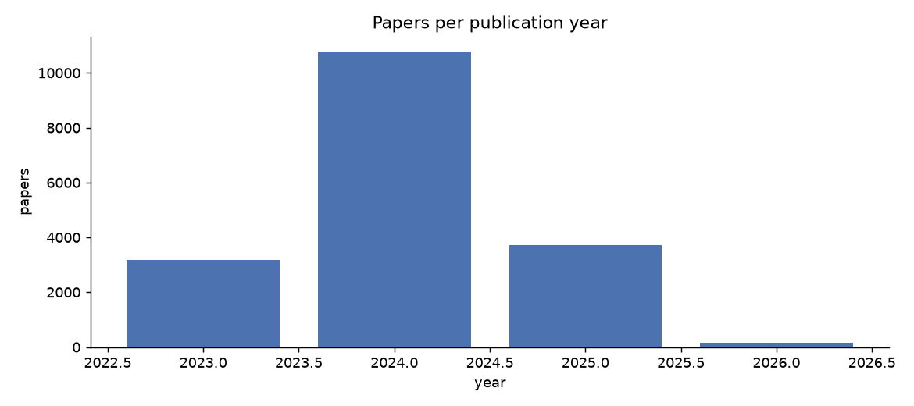
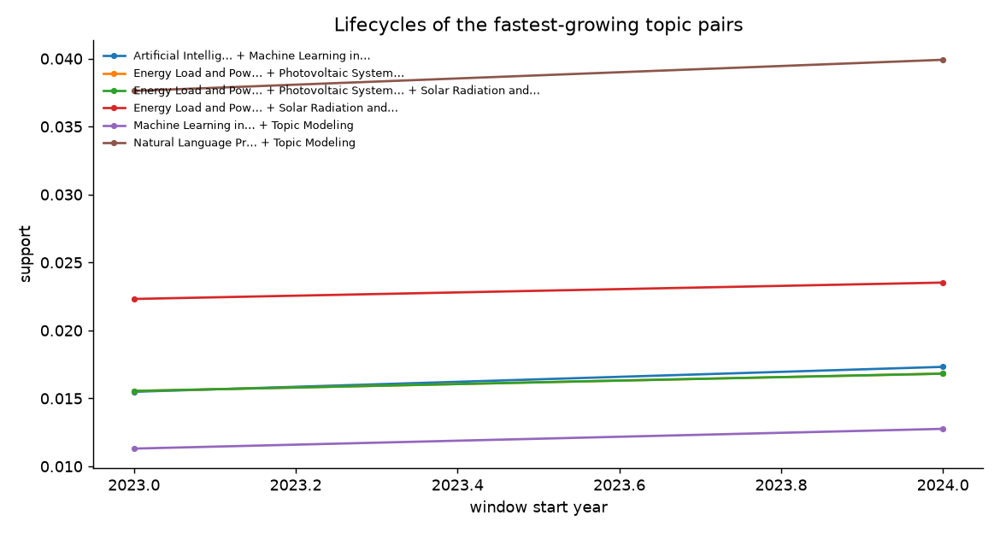
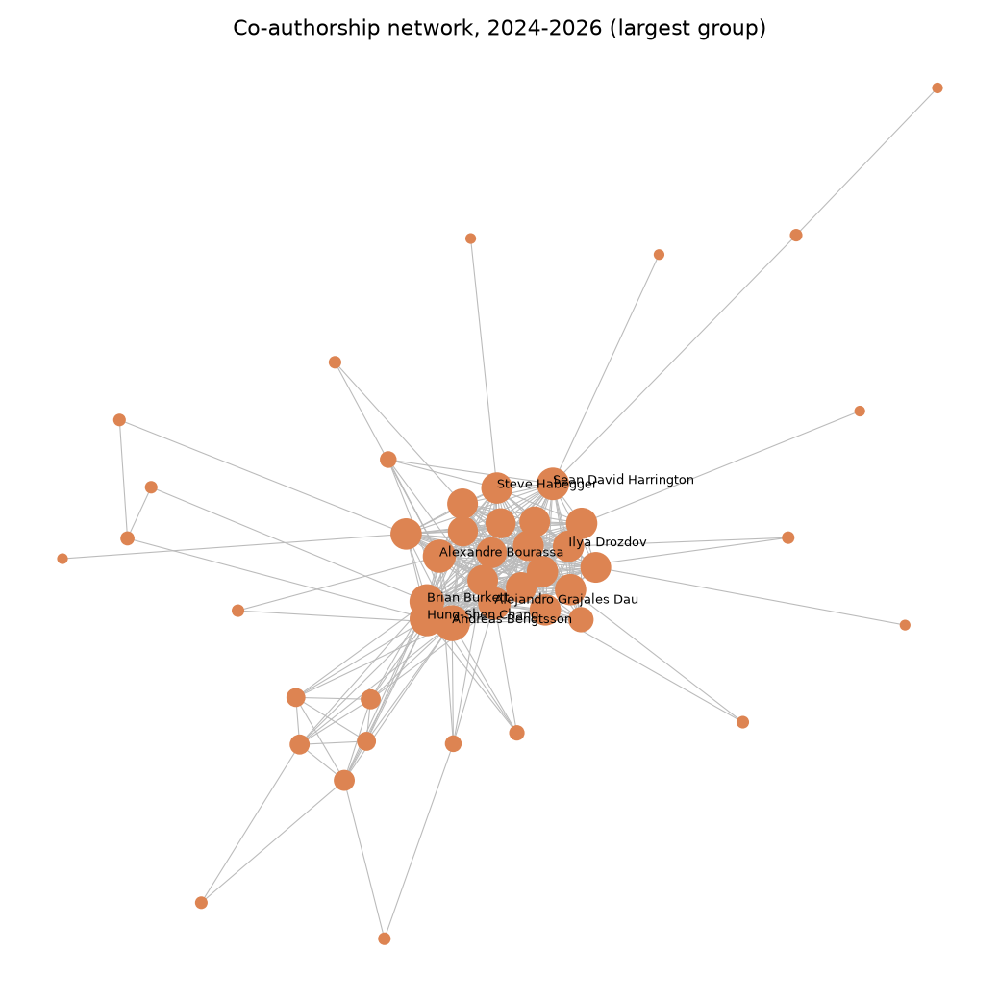
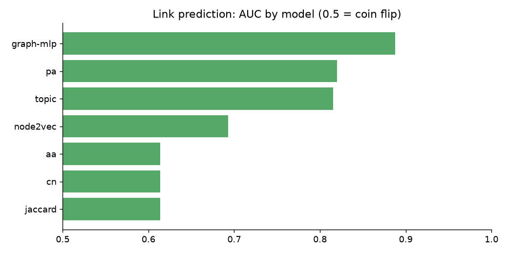

# Weekly snapshot

_Generated 2026-10-11 10:44. Corpus: 17,442 papers, 70,247 authors,
1,401 topics, publication years 2023-2026._

## Emerging topic pairs
| itemset | first_window | first_support | last_window | last_support | change |
|---|---|---|---|---|---|
| Natural Language Processing Techniques | Topic Modeling | 2023 | 0.0381 | 2024 | 0.0403 | 0.0022 |
| Artificial Intelligence in Healthcare and Education | Machine Learning in Healthcare | 2023 | 0.0157 | 2024 | 0.0176 | 0.0019 |
| Machine Learning in Healthcare | Topic Modeling | 2023 | 0.0115 | 2024 | 0.013 | 0.0015 |
| Energy Load and Power Forecasting | Photovoltaic System Optimization Techniques | 2023 | 0.0156 | 2024 | 0.0168 | 0.0012 |
| Energy Load and Power Forecasting | Photovoltaic System Optimization Techniques | Solar Radiation and Photovoltaics | 2023 | 0.0156 | 2024 | 0.0168 | 0.0012 |
| Energy Load and Power Forecasting | Solar Radiation and Photovoltaics | 2023 | 0.0224 | 2024 | 0.0235 | 0.0012 |
| AI in Service Interactions | Technology Adoption and User Behaviour | 2023 | 0.0125 | 2024 | 0.0135 | 0.0011 |
| Artificial Intelligence in Healthcare and Education | Explainable Artificial Intelligence (XAI) | 2023 | 0.0138 | 2024 | 0.0148 | 0.0011 |
| AI in cancer detection | Brain Tumor Detection and Classification | 2023 | 0.0092 | 2024 | 0.0102 | 0.001 |
| Artificial Intelligence in Healthcare and Education | Radiomics and Machine Learning in Medical Imaging | 2023 | 0.0063 | 2024 | 0.0072 | 0.001 |

## Declining topic pairs
| itemset | first_window | first_support | last_window | last_support | change |
|---|---|---|---|---|---|
| Quantum Computing Algorithms and Architecture | Quantum Information and Cryptography | 2023 | 0.0576 | 2024 | 0.0548 | -0.0027 |
| Quantum Computing Algorithms and Architecture | Quantum and electron transport phenomena | 2023 | 0.0139 | 2024 | 0.0122 | -0.0017 |
| Domain Adaptation and Few-Shot Learning | Multimodal Machine Learning Applications | 2023 | 0.0088 | 2024 | 0.0072 | -0.0015 |
| Quantum Information and Cryptography | Quantum and electron transport phenomena | 2023 | 0.0135 | 2024 | 0.0121 | -0.0014 |
| Quantum Computing Algorithms and Architecture | Quantum Information and Cryptography | Quantum and electron transport phenomena | 2023 | 0.0119 | 2024 | 0.0105 | -0.0013 |
| Advanced Multi-Objective Optimization Algorithms | Evolutionary Algorithms and Applications | 2023 | 0.0108 | 2024 | 0.0095 | -0.0013 |
| Advanced Multi-Objective Optimization Algorithms | Evolutionary Algorithms and Applications | Metaheuristic Optimization Algorithms Research | 2023 | 0.0104 | 2024 | 0.0091 | -0.0013 |
| Adversarial Robustness in Machine Learning | Anomaly Detection Techniques and Applications | 2023 | 0.0078 | 2024 | 0.0066 | -0.0012 |
| Evolutionary Algorithms and Applications | Metaheuristic Optimization Algorithms Research | 2023 | 0.0194 | 2024 | 0.0181 | -0.0012 |
| AI in cancer detection | Digital Imaging for Blood Diseases | 2023 | 0.0088 | 2024 | 0.0078 | -0.001 |

## Strongest patterns in 2024-2026
| itemset | k | support_count | n_tx | support |
|---|---|---|---|---|
| Quantum Computing Algorithms and Architecture | Quantum Information and Cryptography | 2 | 750 | 13679 | 0.054828569339864026 |
| AI in cancer detection | Radiomics and Machine Learning in Medical Imaging | 2 | 622 | 13679 | 0.04547116017252723 |
| Natural Language Processing Techniques | Topic Modeling | 2 | 551 | 13679 | 0.0402807222750201 |
| Photovoltaic System Optimization Techniques | Solar Radiation and Photovoltaics | 2 | 344 | 13679 | 0.02514803713721763 |
| Energy Load and Power Forecasting | Solar Radiation and Photovoltaics | 2 | 322 | 13679 | 0.023539732436581622 |
| Cryptography and Data Security | Privacy-Preserving Technologies in Data | 2 | 320 | 13679 | 0.023393522918341986 |
| Quantum Information and Cryptography | Quantum Mechanics and Applications | 2 | 283 | 13679 | 0.02068864683090869 |
| AI in Service Interactions | Digital Marketing and Social Media | 2 | 273 | 13679 | 0.019957599239710504 |
| Advanced Multi-Objective Optimization Algorithms | Metaheuristic Optimization Algorithms Research | 2 | 271 | 13679 | 0.019811389721470868 |
| Anomaly Detection Techniques and Applications | Network Security and Intrusion Detection | 2 | 249 | 13679 | 0.018203085020834855 |

## Collaboration network, 2024-2026
| author | collaborators | joint_papers |
|---|---|---|
| Andreas Bengtsson | 32 | 165 |
| Brian Burkett | 29 | 146 |
| Hung-Shen Chang | 28 | 142 |
| Alejandro Grajales Dau | 26 | 131 |
| Alexandre Bourassa | 25 | 129 |
| Sean David Harrington | 25 | 122 |
| Agustín Di Paolo | 24 | 118 |
| Raja Gosula | 24 | 118 |
| Brooks Foxen | 24 | 117 |
| Michael Broughton | 24 | 117 |

## Link prediction
_no rows_

Top predicted collaborations: [data/predicted_collaborations.csv](data/predicted_collaborations.csv)
