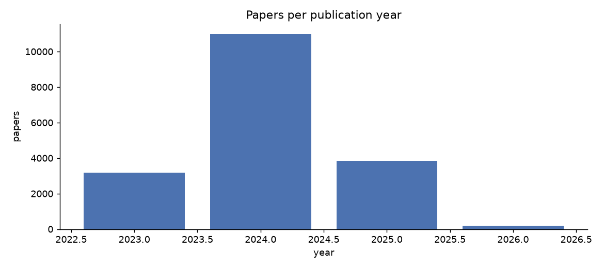
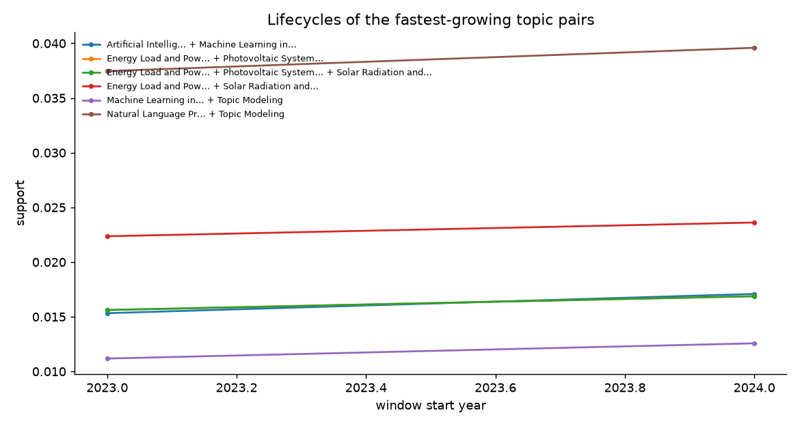
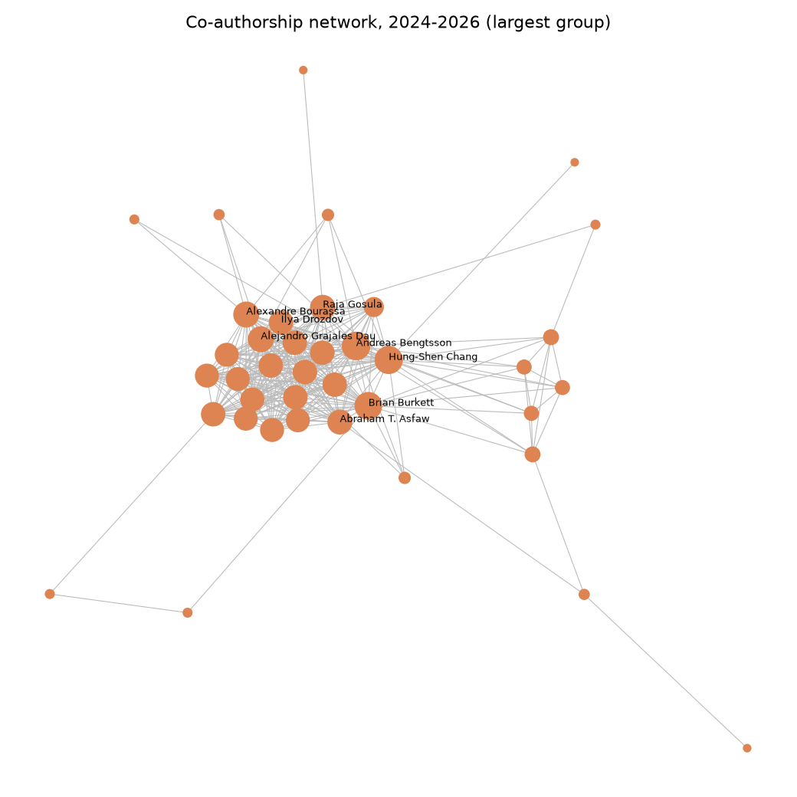
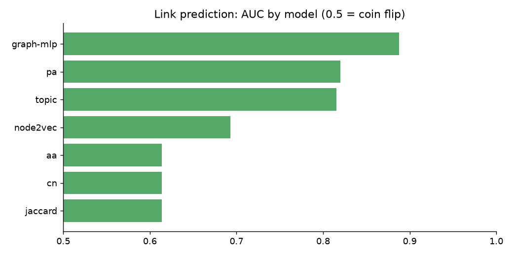

# Weekly snapshot

_Generated 2026-11-01 11:05. Corpus: 18,207 papers, 72,727 authors,
1,420 topics, publication years 2023-2026._

## Emerging topic pairs
| itemset | first_window | first_support | last_window | last_support | change |
|---|---|---|---|---|---|
| Natural Language Processing Techniques \| Topic Modeling | 2023 | 0.0375 | 2024 | 0.0396 | 0.0021 |
| Artificial Intelligence in Healthcare and Education \| Machine Learning in Healthcare | 2023 | 0.0153 | 2024 | 0.0171 | 0.0018 |
| Machine Learning in Healthcare \| Topic Modeling | 2023 | 0.0112 | 2024 | 0.0126 | 0.0014 |
| Energy Load and Power Forecasting \| Photovoltaic System Optimization Techniques | 2023 | 0.0156 | 2024 | 0.0169 | 0.0013 |
| Energy Load and Power Forecasting \| Photovoltaic System Optimization Techniques \| Solar Radiation and Photovoltaics | 2023 | 0.0156 | 2024 | 0.0169 | 0.0013 |
| Energy Load and Power Forecasting \| Solar Radiation and Photovoltaics | 2023 | 0.0224 | 2024 | 0.0236 | 0.0013 |
| AI in Service Interactions \| Technology Adoption and User Behaviour | 2023 | 0.0126 | 2024 | 0.0136 | 0.0011 |
| Photovoltaic System Optimization Techniques \| Solar Radiation and Photovoltaics | 2023 | 0.0243 | 2024 | 0.0253 | 0.001 |
| Artificial Intelligence in Healthcare and Education \| Explainable Artificial Intelligence (XAI) | 2023 | 0.0135 | 2024 | 0.0144 | 0.001 |
| Artificial Intelligence in Healthcare and Education \| Radiomics and Machine Learning in Medical Imaging | 2023 | 0.0061 | 2024 | 0.007 | 0.0009 |

## Declining topic pairs
| itemset | first_window | first_support | last_window | last_support | change |
|---|---|---|---|---|---|
| Quantum Computing Algorithms and Architecture \| Quantum Information and Cryptography | 2023 | 0.0576 | 2024 | 0.0549 | -0.0026 |
| Quantum Computing Algorithms and Architecture \| Quantum and electron transport phenomena | 2023 | 0.0134 | 2024 | 0.0117 | -0.0017 |
| Quantum Information and Cryptography \| Quantum and electron transport phenomena | 2023 | 0.0131 | 2024 | 0.0117 | -0.0014 |
| Domain Adaptation and Few-Shot Learning \| Multimodal Machine Learning Applications | 2023 | 0.0088 | 2024 | 0.0074 | -0.0014 |
| Quantum Computing Algorithms and Architecture \| Quantum Information and Cryptography \| Quantum and electron transport phenomena | 2023 | 0.0114 | 2024 | 0.0101 | -0.0013 |
| Advanced Multi-Objective Optimization Algorithms \| Evolutionary Algorithms and Applications \| Metaheuristic Optimization Algorithms Research | 2023 | 0.0101 | 2024 | 0.0088 | -0.0013 |
| Advanced Multi-Objective Optimization Algorithms \| Evolutionary Algorithms and Applications | 2023 | 0.0104 | 2024 | 0.0092 | -0.0013 |
| Evolutionary Algorithms and Applications \| Metaheuristic Optimization Algorithms Research | 2023 | 0.019 | 2024 | 0.0178 | -0.0012 |
| Adversarial Robustness in Machine Learning \| Anomaly Detection Techniques and Applications | 2023 | 0.0077 | 2024 | 0.0065 | -0.0011 |
| AI in cancer detection \| Digital Imaging for Blood Diseases | 2023 | 0.0089 | 2024 | 0.0079 | -0.001 |

## Strongest patterns in 2024-2026
| itemset | k | support_count | n_tx | support |
|---|---|---|---|---|
| Quantum Computing Algorithms and Architecture \| Quantum Information and Cryptography | 2 | 791 | 14396 | 0.05494581828285635 |
| AI in cancer detection \| Radiomics and Machine Learning in Medical Imaging | 2 | 663 | 14396 | 0.046054459572103364 |
| Natural Language Processing Techniques \| Topic Modeling | 2 | 570 | 14396 | 0.0395943317588219 |
| Photovoltaic System Optimization Techniques \| Solar Radiation and Photovoltaics | 2 | 364 | 14396 | 0.025284801333703807 |
| Energy Load and Power Forecasting \| Solar Radiation and Photovoltaics | 2 | 340 | 14396 | 0.02361767157543762 |
| Cryptography and Data Security \| Privacy-Preserving Technologies in Data | 2 | 331 | 14396 | 0.022992497916087803 |
| Quantum Information and Cryptography \| Quantum Mechanics and Applications | 2 | 297 | 14396 | 0.02063073075854404 |
| Advanced Multi-Objective Optimization Algorithms \| Metaheuristic Optimization Algorithms Research | 2 | 289 | 14396 | 0.02007502083912198 |
| AI in Service Interactions \| Digital Marketing and Social Media | 2 | 287 | 14396 | 0.019936093359266462 |
| Evolutionary Algorithms and Applications \| Metaheuristic Optimization Algorithms Research | 2 | 256 | 14396 | 0.017782717421505972 |

## Collaboration network, 2024-2026
| author | collaborators | joint_papers |
|---|---|---|
| Andreas Bengtsson | 31 | 161 |
| Hung-Shen Chang | 30 | 150 |
| Brian Burkett | 29 | 146 |
| Alexandre Bourassa | 25 | 129 |
| Alejandro Grajales Dau | 25 | 127 |
| Raja Gosula | 24 | 118 |
| Abraham T. Asfaw | 23 | 114 |
| Agustín Di Paolo | 22 | 110 |
| Ilya Drozdov | 22 | 110 |
| Joseph C. Bardin | 22 | 110 |

## Link prediction
_no rows_

Top predicted collaborations: [data/predicted_collaborations.csv](data/predicted_collaborations.csv)
