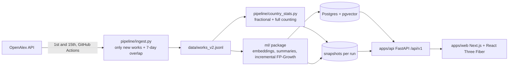
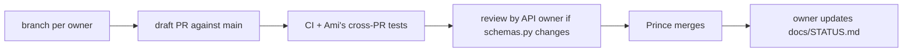

# Workflow design

## Data flow

## Team workflow

Rules: build only against `apps/api/app/schemas.py`; one owner per folder;
never rebuild patterns from scratch, always merge onto the last snapshot;
every PR updates `docs/STATUS.md`.
