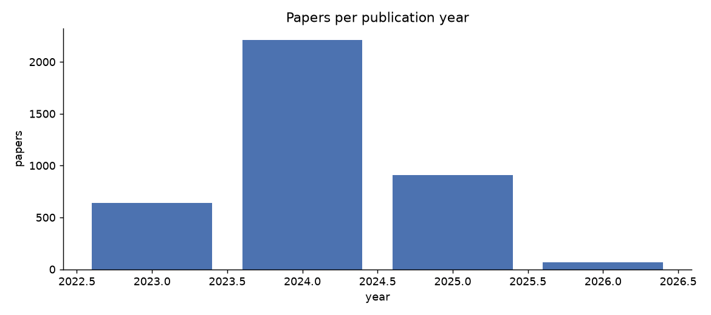
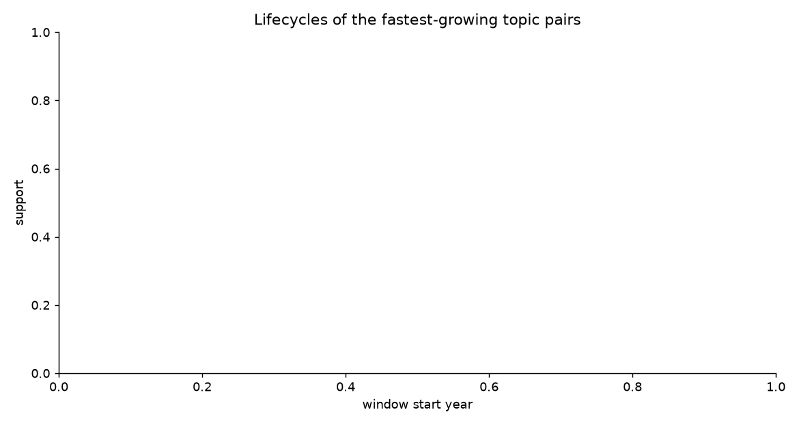
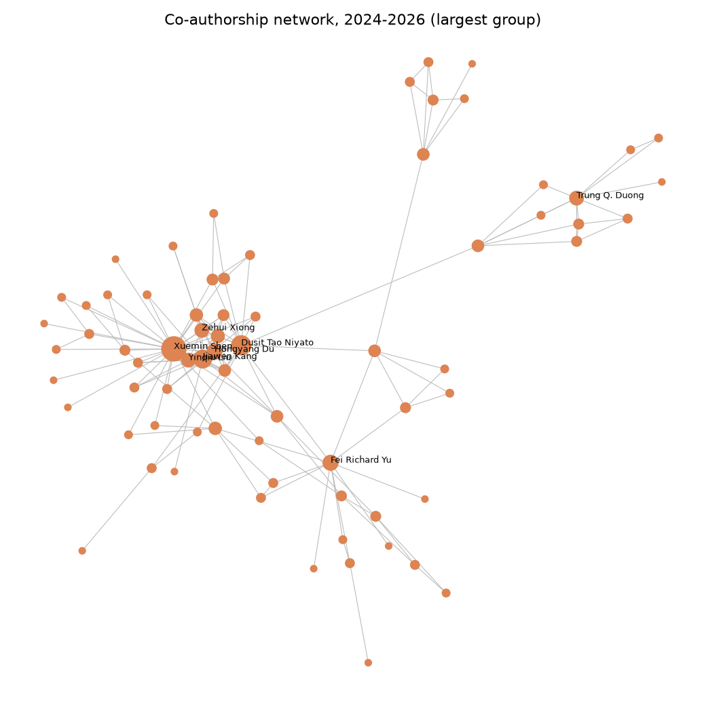
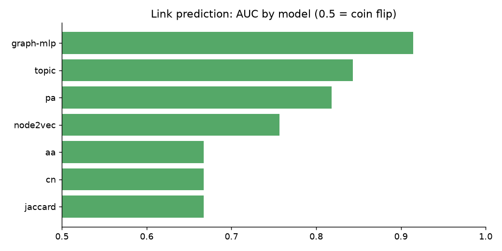

# Weekly snapshot

_Generated 2026-11-01 11:07. Corpus: 3,822 papers, 18,831 authors,
1,112 topics, publication years 2023-2026._

## Emerging topic pairs
_no rows_

## Declining topic pairs
| itemset | first_window | first_support | last_window | last_support | change |
|---|---|---|---|---|---|
| Quantum Computing Algorithms and Architecture \| Quantum Information and Cryptography | 2023 | 0.0388 | 2024 | 0.0355 | -0.0033 |

## Strongest patterns in 2024-2026
| itemset | k | support_count | n_tx | support |
|---|---|---|---|---|
| Quantum Computing Algorithms and Architecture \| Quantum Information and Cryptography | 2 | 108 | 3042 | 0.03550295857988166 |
| Anomaly Detection Techniques and Applications \| Network Security and Intrusion Detection | 2 | 66 | 3042 | 0.021696252465483234 |

## Collaboration network, 2024-2026
| author | collaborators | joint_papers |
|---|---|---|
| Xuemin Shen | 31 | 199 |
| Dusit Tao Niyato | 19 | 151 |
| Habib Hamam | 18 | 123 |
| Jiawen Kang | 16 | 111 |
| Witold Pedrycz | 14 | 55 |
| Hongyang Du | 11 | 93 |
| Fei Richard Yu | 11 | 45 |
| Tehseen Mazhar | 10 | 84 |
| Zehui Xiong | 9 | 78 |
| Trung Q. Duong | 9 | 45 |

## Link prediction
| model | auc | ap |
|---|---|---|
| graph-mlp | 0.91453636 | 0.9300244 |
| topic | 0.84341997 | 0.82834053 |
| pa | 0.81823343 | 0.8359255 |
| node2vec | 0.7564105 | 0.78495276 |
| aa | 0.6672695 | 0.6669321 |
| cn | 0.6672423 | 0.6668721 |
| jaccard | 0.6670818 | 0.6659139 |

Top predicted collaborations: [data/predicted_collaborations.csv](data/predicted_collaborations.csv)
