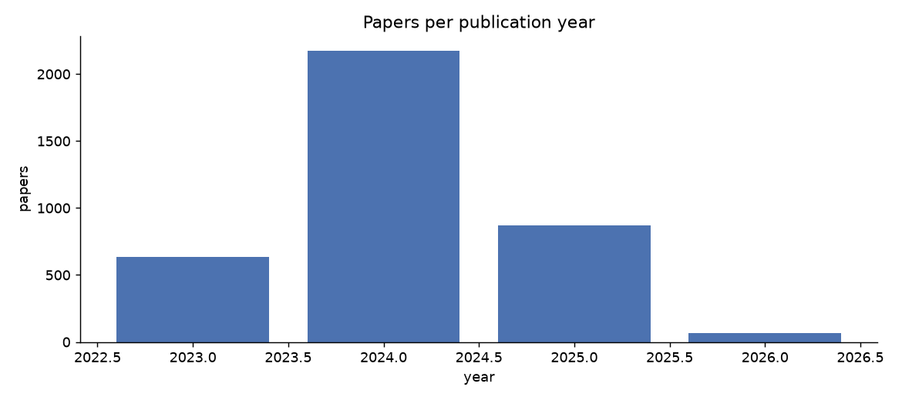
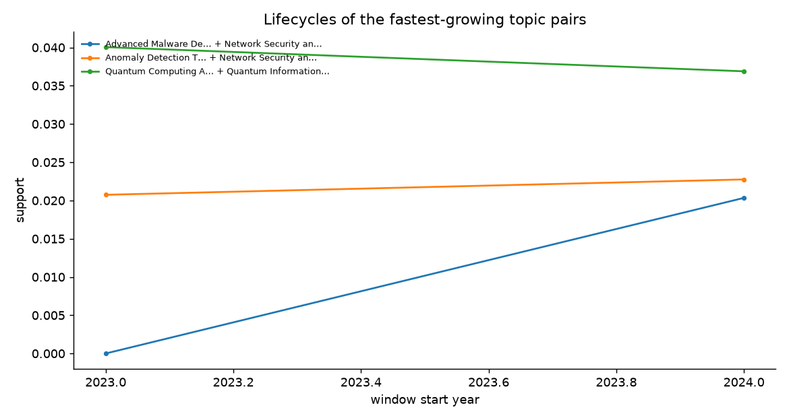
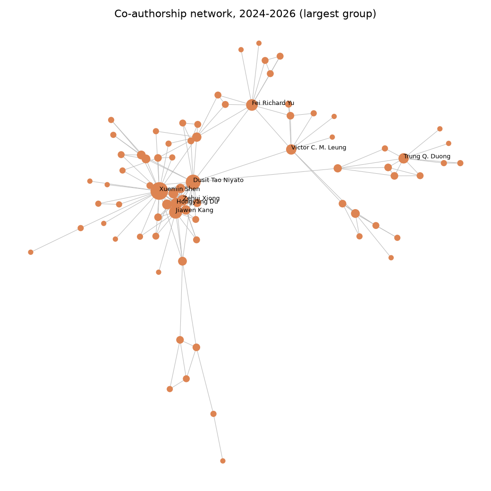
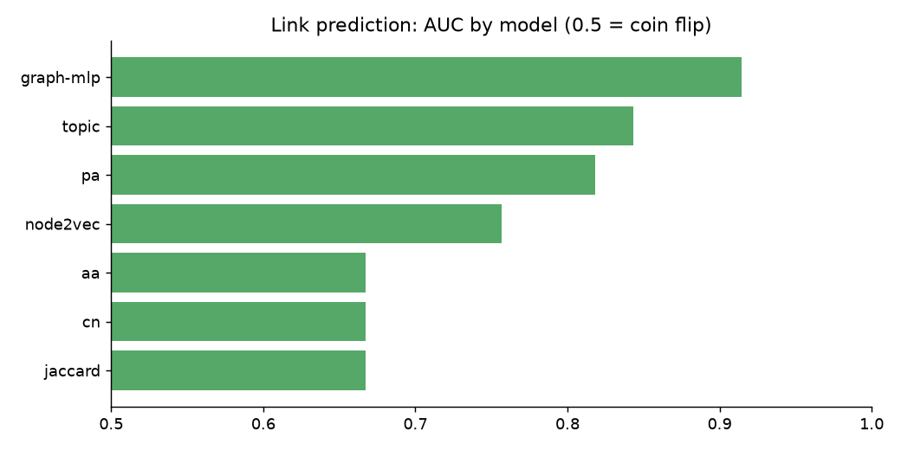

# Weekly snapshot

_Generated 2026-10-18 08:49. Corpus: 3,745 papers, 18,576 authors,
1,102 topics, publication years 2023-2026._

## Emerging topic pairs
| itemset | first_window | first_support | last_window | last_support | change |
|---|---|---|---|---|---|
| Anomaly Detection Techniques and Applications \| Network Security and Intrusion Detection | 2023 | 0.0204 | 2024 | 0.0223 | 0.0019 |

## Declining topic pairs
| itemset | first_window | first_support | last_window | last_support | change |
|---|---|---|---|---|---|
| Quantum Computing Algorithms and Architecture \| Quantum Information and Cryptography | 2023 | 0.0396 | 2024 | 0.0364 | -0.0032 |

## Strongest patterns in 2024-2026
| itemset | k | support_count | n_tx | support |
|---|---|---|---|---|
| Quantum Computing Algorithms and Architecture \| Quantum Information and Cryptography | 2 | 108 | 2966 | 0.03641267700606878 |
| Anomaly Detection Techniques and Applications \| Network Security and Intrusion Detection | 2 | 66 | 2966 | 0.022252191503708697 |

## Collaboration network, 2024-2026
| author | collaborators | joint_papers |
|---|---|---|
| Xuemin Shen | 30 | 196 |
| Dusit Tao Niyato | 22 | 160 |
| Habib Hamam | 19 | 126 |
| Jiawen Kang | 16 | 111 |
| Witold Pedrycz | 15 | 58 |
| Fei Richard Yu | 12 | 48 |
| Tehseen Mazhar | 11 | 87 |
| Hongyang Du | 10 | 90 |
| Zehui Xiong | 10 | 81 |
| Roberto Morandotti | 10 | 36 |

## Link prediction
| model | auc | ap |
|---|---|---|
| graph-mlp | 0.91453636 | 0.9300244 |
| topic | 0.84341997 | 0.82834053 |
| pa | 0.81823343 | 0.8359255 |
| node2vec | 0.7564105 | 0.78495276 |
| aa | 0.6672695 | 0.6669321 |
| cn | 0.6672423 | 0.6668721 |
| jaccard | 0.6670818 | 0.6659139 |

Top predicted collaborations: [data/predicted_collaborations.csv](data/predicted_collaborations.csv)
